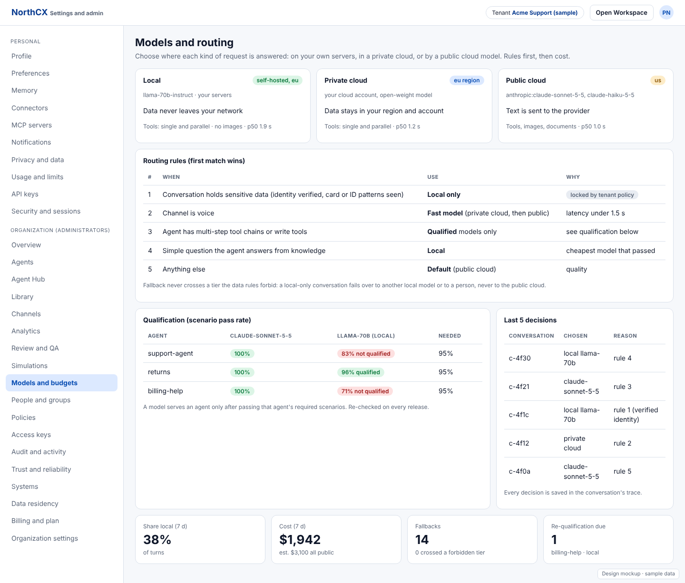
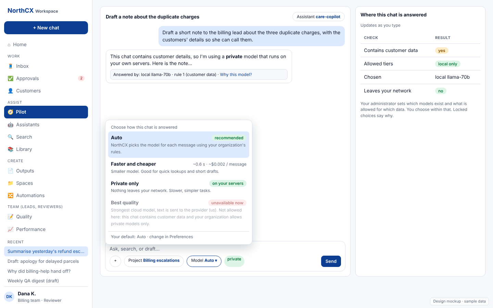
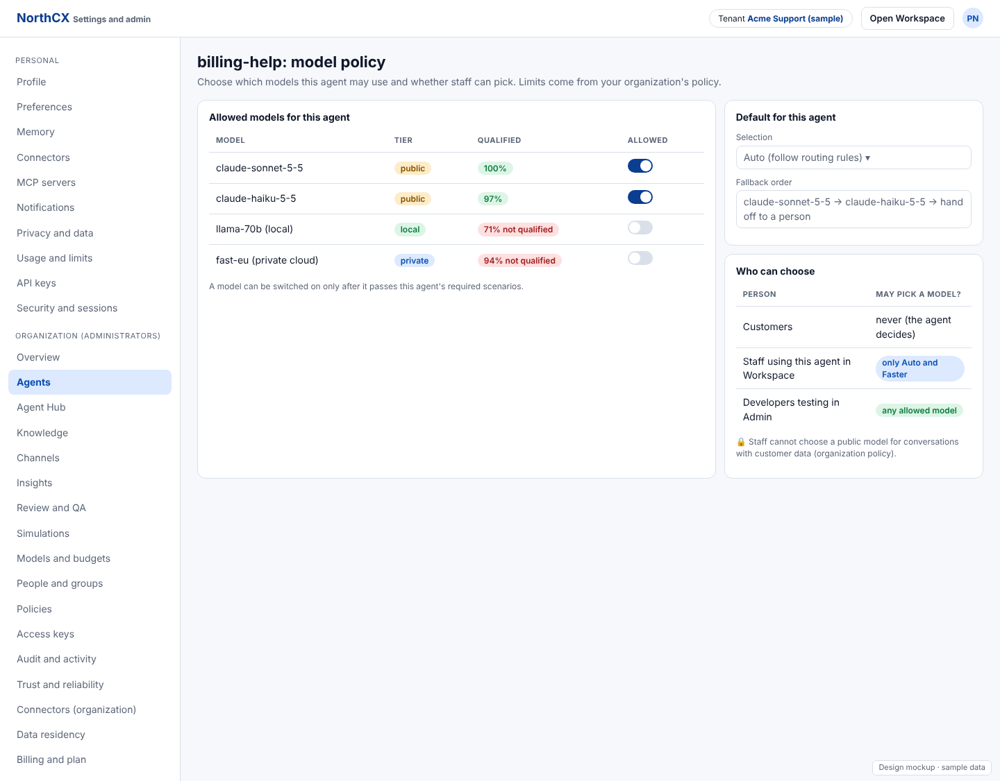

# Hybrid model selection: local, private cloud and public cloud

Status: **proposed** (2026-11-09). Nothing here is built except the pieces named under "What exists". It extends the provider layer (`NorthCX_Model-Providers.md`, E1 in the implementation plan). Evidence and sources are in `00-reference/NorthCX_Feature-Research-2026-11.md` section 11.

(Mockup, sample data.)

## 1. The problem
Some customers need data to stay on their own servers; some conversations are too sensitive for any outside provider; some work is simple enough that a small local model is cheaper and fast enough; some work (multi-step tool use, writing actions) needs the strongest model available. A single global model setting cannot express this. NorthCX should choose the model **per request, by rules the operator controls**, and record why.

## 2. Three tiers
| Tier | Where it runs | Data path | Typical use |
|---|---|---|---|
| **Local** | the operator's own servers (any self-hosted server that speaks the common chat format) | never leaves the operator's network | sensitive conversations, simple questions, offline or sovereign installs |
| **Private cloud** | the operator's own cloud account and region | stays in their account and region | fast, regional, still under operator control |
| **Public cloud** | a model provider's service | text is sent to the provider | strongest quality, images and documents |

A provider in the providers file (WP1.4) declares its tier, region, capabilities and prices. The residency report already lists every destination text can go to; tiers extend it.

## 3. How a model is chosen: constraints, then qualification, then cost
1. **Constraints (hard, never traded away).** Which tiers may this conversation use? Inputs: the tenant's data policy, whether the conversation has been marked sensitive (identity verified, personal-data patterns seen by the masking detector, an attachment), the channel, and the agent's needs (tools, images). Result: the **eligible set**. If it is empty, the conversation goes to a person, never to a forbidden tier.
2. **Qualification.** A model may serve an agent only if it passed that agent's required scenarios at the agent's threshold (default 95 percent), checked at release and again whenever the model, prompt or tools change. This is the guard against a cheap model that cannot do the job.
3. **Preference.** Among eligible, qualified models: the rules the operator wrote (first match wins), then lowest cost, then lowest latency.
4. **Fallback.** The existing retry and fallback chain, restricted to the eligible set: a local-only conversation fails over to another local model or to a person.
5. **Record.** The chosen model, the rule that chose it and the models skipped (with the reason) go into the conversation's trace, so the choice can be audited and explained.

Rules are data, not code: a short ordered list of "when (conditions) use (tier, model or class)". Conditions are only things NorthCX already knows: tier policy, sensitivity mark, channel, agent, tool effect (read or write), language, estimated turn size.

## 4. Different jobs, different choices
The same selection applies to each purpose, with its own rules: the agent's replies, the supervisor and guardrail checks, summaries, the judge and simulations, meaning-search embeddings, transcription. Examples: embeddings and summaries default to local where available; the judge should not be the same model that produced the answer; transcription of sensitive recordings stays local.

## 5. Two ways to save cost, and which to trust
- **Rules plus qualification** (above): predictable, explainable, testable with the existing simulations. This is the recommendation.
- **Cheap model first, escalate on failure (cascade):** needs a quality check on every answer, and the evidence says that check is the hard part. Offer it only for low-stakes agents and measure it on scenarios before enabling.
- **Learned router** (a model that predicts which model to call): published results report large savings on general benchmarks, but they are not customer-support results and not our tools. Treat as a later experiment, recorded in traces and compared with the rule-based path in a scenario.

## 6. What the evidence says about local models
Controlled evidence is thin. One preprint comparing small open-weight models with a frontier model on tool use found parity on simple single-tool tasks, and a clear gap on the hardest tasks, with multi-step chains the weak point; no open model reached the bar for sequential two-tool chains. Support agents often live in exactly those chains. So local models should start with **read-only, single-step, knowledge-answering work** and earn more through the qualification above on the operator's own scenarios. This is a reason for the qualification gate, not a reason against local models.

## 7. What exists
- `provider:model` names, the registry, capability declarations, `require_tools`, retries and fallback (WP1.1, 1.2).
- Residency report of every destination; strict mode that refuses to start with a destination outside the allowed regions.
- Simulation gate on release (required scenarios), the judge and a replay of recorded conversations.
- Masking detector (personal data patterns) and the identity-verified fact.
- Traces that can carry extra fields.

## 8. What would be built (proposed work packages, after WP1.3 to WP1.5)
| WP | Work | Size |
|---|---|---|
| 1.9 | Provider tier and region fields; the eligible-set function; per-conversation sensitivity mark; fallback restricted to the eligible set; trace record of the decision | M |
| 1.10 | Routing rules file (ordered rules, validated), rule evaluation, `NORTHCX_ROUTING_RULES_FILE`; per-purpose defaults | M |
| 1.11 | Qualification: run an agent's required scenarios against a candidate model, store the result per agent and model, refuse to route to an unqualified model, re-check on release | M |
| 1.12 | Studio and Admin screens: tiers, rules, qualification table, decision log, share local, cost saved | M |
| 1.13 (experiment) | Cascade and learned router behind a flag, compared in scenarios | M |

## 10. How people choose
Choice is layered. Each layer can only narrow what the layer above allows, and a locked option says who locked it and why.

| Who | What they choose | Where |
|---|---|---|
| **Administrator** | Which providers and models exist, their tier and region, the routing rules, the data policy (which data may go where), the qualification threshold, which roles may pick a model at all | Admin: Models and routing, Policies |
| **Agent owner** | Which of the allowed models this agent may use (only models that passed its scenarios), its default selection (Auto or a named model), its fallback order, whether staff may pick | Admin: the agent's model policy |
| **Staff member** | In a Workspace chat: **Auto** (recommended, rules decide), **Faster and cheaper**, **Best quality**, or **Private only**; a personal default in Preferences. Only options the policy allows are selectable; the rest show why they are unavailable | Workspace: the model picker beside the prompt |
| **Developer** | Any model allowed for the agent, when testing in Admin or running a scenario against a candidate model | Admin: test console and simulations |
| **Customer** | Nothing; the agent and the rules decide | |

The picker offers **modes**, not model names, because names change and most people cannot judge them; the model actually used is always shown on the answer ("Answered by ..., rule 1, why this model?"). Each mode shows speed, an estimated cost per message, and where the text goes (your servers, your region, the provider's). A side panel states what the chat contains (customer data or not), which tiers are allowed, what was chosen and whether anything leaves the network, and updates as the person types. When customer data appears in a chat that started on a cloud model, the next message switches to a private model and says so; it never silently sends the data on.

Mockups (sample data): the picker in a Workspace chat, and the agent's model policy.

Backend this needs, beyond WP1.9 to WP1.13: a request field for the chosen mode, a per-chat mode stored with the conversation, the sensitivity check running before each message, and the decision (mode, rule, models skipped) returned with the reply so the interface can show it.

## 9. Decisions (decided by the owner, 2026-11-09, decision 164; replaces the earlier recommendations)
1. **What marks a conversation sensitive.** Customer personal data present; an account, payment or health topic; or an administrator marking the agent sensitive. Operators may add categories. Identity-verified conversations are sensitive by default.
2. **Qualification threshold** per agent and model: 100 percent of the agent's required safety scenarios and at least 90 percent of its other scenarios. The figures are to be validated on a real pilot; the earlier 95 percent placeholder is withdrawn.
3. **Where an unqualified model may run.** Only on read-only, single-step work with no customer data, until it passes the agent's own scenarios; evaluation in staging is always allowed. It never handles a customer conversation.
4. **Public cloud and sensitive data.** Never by default. An administrator may allow it explicitly for a named agent, with the policy locked and every use audited. Fallback never crosses this limit.
