# NorthCX admin platform and staff workspace: design proposal

Status: **proposed** (2026-11-09). Nothing here is built yet except what the "Today" column says. The screens are static mockups with sample data (a company called "Acme Support" is invented for the pictures); they show intent, not working software. Sources: the current Studio, the implementation plan (E1, E3, E5, E7, E10), and the market research in `00-reference/NorthCX_Feature-Research-2026-11.md`.

> **Names in this document.** Several sections were written before the Workspace tab names were finalized and still use the old ones (Threads, Chat, Knowledge, Artifacts, Projects, Workflows, Scheduled, Reviews, Insights; and in Admin Knowledge, Insights, Connectors (organization) and Settings, now Library, Analytics, Systems and Organization settings). The current names, the tab list and the status of each feature are in `NorthCX_Platform-Features-and-Tabs.md`, which takes precedence. The mockup images were regenerated with the new names.

Source files: `07-design/mockups/*.html` (regenerate with `python scripts/gen_design_mockups.py`, then `node scripts/shoot_mockups.js`). Images: `assets/design/`.

## 0. Layout decided on 2026-11-09 (supersedes the earlier arrangement where they differ)
The owner described the layout; the two windows are:

**Window 1, Workspace (the agent platform for staff).** Left side: a navigation list (**Chat, Assistants, Search, Artifacts, Projects, Scheduled, Threads**), a "New chat" button, recent chats and the signed-in person. Right side: the **working space**, which shows the selected area. In Chat it is the conversation next to an artifact panel (the thing being produced, with copy, edit, share and schedule). Threads is where customer conversations that need a person are handled (the queue, the approval card, the draft reply).

| Left item | What it is | Mockup |
|---|---|---|
| Chat | Talk to a staff assistant (search, summarise, draft, report); answers cite sources; outputs open as artifacts |  |
| Assistants | The predefined assistants this person may use (Agent Hub entries made available to them): search, favorites, what each can see and do, start a chat |  |
| Search | One search across knowledge, conversations, hand-offs and artifacts, with the access reason on each result |  |
| Artifacts | Library of everything produced (summaries, drafts, reports, digests): versions, share to team, schedule, export. **Not drawn yet**; the artifact panel in Chat shows one | (see Chat) |
| Projects | Instructions, sources, chats and artifacts kept together for one piece of work (team or private) | 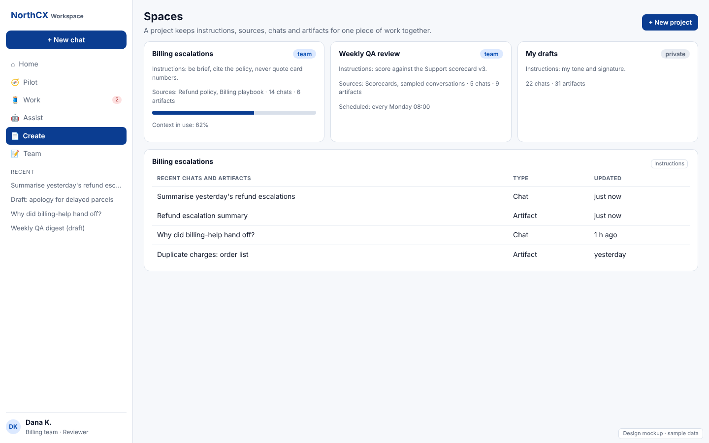 |
| Scheduled | Tasks that run on their own and leave an artifact or message; run history, pause, failures shown |  |
| Threads | Customer conversations: needs me, agent is handling, resolved; approvals and replies | 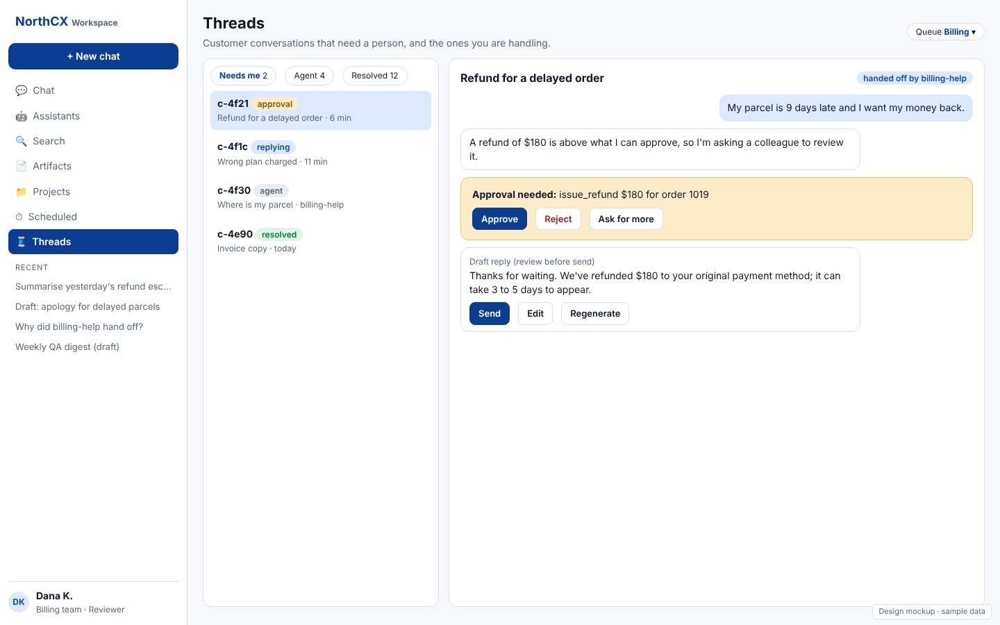 |

**Window 2, Settings and admin (the admin platform).** A wide settings app opened from the profile menu. Left: **Personal** options (Profile, Preferences, Memory, Connectors, MCP servers, Notifications, Privacy and data, Usage and limits, API keys, Security and sessions) and an **Organization (administrators)** group (People and groups, Agents, Models and budgets, Policies, Access, Audit and activity, Connectors (organization), Data residency, Billing and plan). Everyone sees the Personal group; the Organization group appears only for roles that can use it. The organization pages are the admin screens drawn earlier (sections 3 and below).

| Option | What it holds | Mockup |
|---|---|---|
| Profile | Name, team, language, time zone, default assistant, reply style, signature; roles shown read-only |  |
| Memory | What assistants remember: read, edit, erase, export; personal and team; on/off |  |
| Connectors and MCP servers | Connect systems, see scopes, enable or disable individual tools; remote tools write-by-default and approval-gated; organization policy can lock third-party servers | 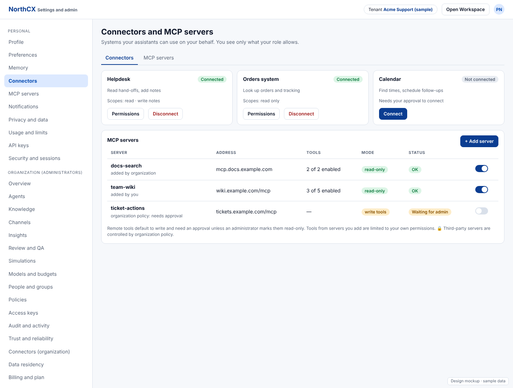 |

What exists today for these: memory (with recall, edit and erase APIs for customers; staff and team memory are E5.5), connectors from files (no screens), MCP is not built (E4), scheduled tasks exist only for knowledge re-crawls (E8 is the automation work), artifacts and projects do not exist (E6, E5). The earlier three-column and session-style Workspace mockups (09, 15) remain as variants for the Threads page.

## 0a. New interfaces, round 2 (2026-11-09)
Added after the feature research (`00-reference/NorthCX_Feature-Research-2026-11.md`, sections 7 to 10). Each is a candidate, not a commitment; most need new backend work. All sample data.

**Workspace**
| Screen | What it adds | Mockup |
|---|---|---|
| Home | Landing view: what needs you, what is ready, recent work, suggestions, a prompt with assistant, project and sources chosen up front |  |
| Artifacts library | Everything produced: filter by type, project and owner; versions; share, schedule, export |  |

**Admin (Settings and admin, Organization group; the grouped navigation now lists Overview, Agents, Knowledge, Channels, Insights, Review and QA, Simulations, Models and budgets, People and groups, Policies, Access keys, Audit and activity, Trust and reliability, Connectors, Data residency, Billing and plan)**
| Screen | What it adds | Mockup |
|---|---|---|
| Insights: Explorer | Ask a question in plain language; finding with figures, masked samples, recommendations that lead straight to an action (draft an article, review a limit, create a scenario), follow-ups; audited |  |
| Knowledge: suggested articles | Drafts written from how people resolved similar cases, each claim linked to its source, checks before publishing, nothing live until approved |  |
| Improve an agent | A session that investigates a problem, proposes a spec change as a diff, tests it (required scenarios, new scenarios, replay of past conversations) and sends it to a reviewer; nothing goes live from it |  |
| Channels | All six channels in one table with address, agent, volume, hand-off rate and health; same rules on every channel; test a channel |  |
| Trust and reliability | Guardrail blocks, supervisor interventions, a scheduled adversarial suite with trend, protections in place, and a list of what has **not** been done (penetration test, live-model pass, certifications) |  |
| Privacy and data (personal) | What is kept and for how long, export and erase, where your text goes |  |

Backend reality: Explorer's masked drill-down and suggested articles are not built (and the drill-down is a privacy decision); the improvement session reuses drafting, scenarios and replay that exist but lacks the loop; channels data exists; the adversarial suite, trend and trust page are new; the artifact library, home and projects need E5/E6.

## 0b. More Workspace tabs: what is needed (proposal, 2026-11-09)
The seven decided tabs (Chat, Assistants, Search, Artifacts, Projects, Scheduled, Threads) cover the working surface. Customer-service agent desktops add a few more areas; a search of their documentation shows they mostly put customer profile, suggested knowledge, macros and scripts in a **side panel inside the conversation**, not as separate areas ([Dynamics 365 productivity pane](https://learn.microsoft.com/en-us/dynamics365/customer-service/csw-productivity-pane), [8x8 customer 360 panel](https://docs.8x8.com/8x8WebHelp/contact-center/agent-workspace/Content/aw/customer-360-with-local-crm.htm), [Zendesk agent workspace](https://www.getmacha.com/blog/zendesk-agent-workspace-explained)); coaching and QA did not turn up in that search. So the proposal adds only what needs a page of its own, and keeps the list grouped.

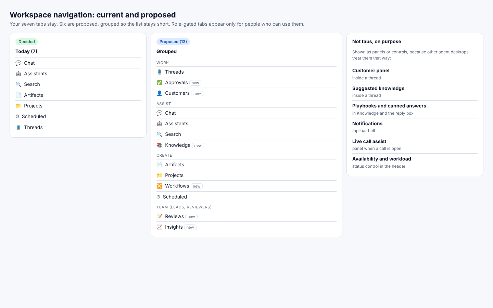

| Proposed tab | Why it is a tab | Who sees it | Backend reality | Mockup |
|---|---|---|---|---|
| **Approvals** | Decisions are time-critical and span conversations; a badge in the navigation shows the count | everyone who can approve | Approvals and their decisions exist; this is a screen | 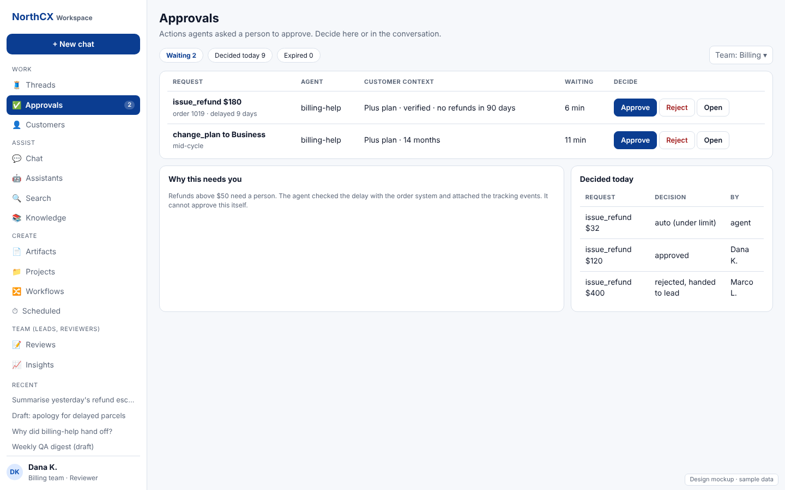 |
| **Customers** | A person across every channel: timeline, facts agents may use, notes, satisfaction | roles allowed to see customers | Facts, conversations and erasure by customer id exist; a cross-channel customer record and timeline do not (the same missing link as the reopen rate). A privacy decision as well: who may see which customer data | 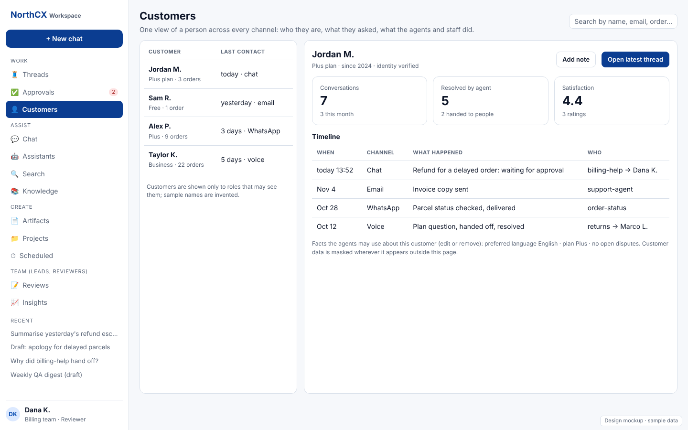 |
| **Knowledge** | Browse and search sources, propose edits, playbooks and canned answers | everyone (edit rights by role) | Knowledge store and search exist; playbooks and canned answers are new | |
| **Reviews** | A reviewer's own queue, scorecards, coaching notes | reviewers, leads | Review queue exists in Studio; scorecards and coaching are E7 | |
| **Insights** | My numbers and my team's: handled, resolved, approvals, response times | leads (team), everyone (own) | Insights exist at organization level; per-person and per-team views are E15 | |

Shown as panels or controls, not tabs: customer panel and suggested knowledge (inside a thread), playbooks and canned answers (in Knowledge and the reply box), notifications (top-bar bell), live call assist (a panel when a call is open), availability and workload (a status control in the header). Not proposed for now: a team chat or presence page, workforce scheduling, and a separate voice dialler; each would need its own decision.

## 0c. Workflows (proposal, 2026-11-09)
A **Workflows** tab in the Workspace (Create group, above Scheduled; the navigation proposal is now 13 tabs). It is the interface for the automations work already planned in E8 (runner, triggers, safety, builder) and the visual editor in E14.

**What a workflow is.** A trigger, then steps, with people where needed: *starts when* (a schedule, a webhook, an event such as "approval waiting 15 minutes", or a person pressing run), *get data* (a connector read), *assistant* (an agent run with a prompt and an allow-list of tools), *check* (a condition), *person* (waits for a decision, with a time limit and what happens next), *action* (tag, create an artifact, notify, or a write that needs approval). Runs can wait for people for hours; state is saved so a restart does not lose them.

**How it differs from what exists.** *Journeys* are the guided flows inside a customer-facing agent's conversation. *Scheduled* tasks are the simple case: a workflow whose trigger is a schedule. Workflows are staff and back-office automations. Recommended: keep the Scheduled tab for now as a filtered view of workflows that start on a schedule, and merge them once Workflows exists.

| Screen | What it shows | Mockup |
|---|---|---|
| List | Describe-it box (natural-language draft, reviewed and tested before anything is saved), tabs All, Mine, My team, Needs attention; trigger, steps, owner, last run, status, on/off |  |
| Editor | Canvas of steps with a list view that shows the same workflow as text (keyboard operation), step settings, limits and safety (time, steps, budget, runs at once, write steps need approval, kill switch), checks before publishing |  |
| Run | Step-by-step timeline with results, tokens and cost, the person step waiting, what happens on failure (retry from a step, skip, stop), recent runs | 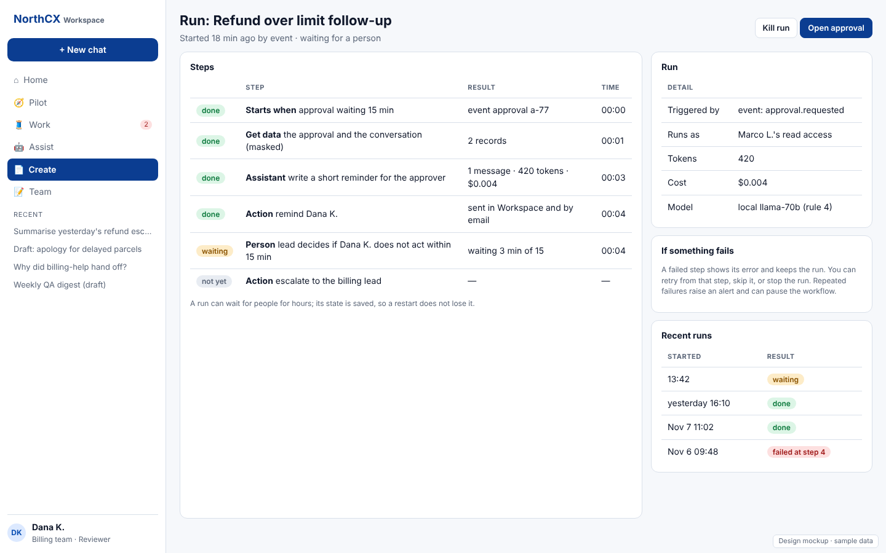 |

**Safety rules (from E8).** A workflow runs with its owner's read access and a service identity; a step that writes goes through the same approvals as a chat; one run at a time by default, a time limit, a step cap and a budget per run; a kill switch per workflow and per team; failures raise alerts; the natural-language builder only produces a validated draft with a dry run, never a saved or running workflow; every definition is versioned and published through a reviewer when it contains a write step.

**Admin side.** Policies gains the workflow rules (who may publish, which connectors workflows may call, default limits, where the kill switch sits); Usage and cost counts workflow runs per team; Audit and activity records publishes, runs of write steps and kill-switch use; Trust and reliability lists failing workflows.

**Backend reality.** Nothing exists except knowledge re-crawl schedules and the claim-once scheduler, and the job leases from WP0.5 that a runner would build on. Durable run state, triggers, the runner, the builder and the editor are E8 and E14 (Wave 3).

**Decisions needed.** (1) Merge Scheduled into Workflows now or later. (2) Who may publish a workflow: any staff member for read-only workflows, a reviewer when there is a write step (recommended). (3) Whether workflows may call customer-facing agents (not recommended at first).

## 0d. Which tabs are required, and when (recommendation, 2026-11-09)
Ordered by what the product cannot work without, then by what the backend can support today.

| Tier | Workspace tabs | Why | Backend today |
|---|---|---|---|
| **Required for the first Workspace release** | Threads, Approvals, Chat, Assistants, Search, Knowledge | A person must be able to take over a conversation, decide an approval, ask an assistant, find an answer and read the source | Threads, Approvals, Knowledge and a first Search use what exists (hand-offs, approvals, knowledge search); Chat and Assistants need the staff backend (E5) and the Agent Hub entries |
| **Next** | Artifacts, Customers, Reviews, Insights | Outputs people keep, a person across channels, reviewer work, team numbers | Artifacts E6; Customers needs a customer link and a privacy decision; Reviews E7; Insights E15 |
| **Later** | Projects, Workflows, Scheduled | Useful grouping and automation, but not needed to work a conversation | Projects E5/E6; Workflows and Scheduled E8 and E14 |

Admin required for the first release: Overview, Agents, Knowledge, Channels, Access keys, Audit and activity, Policies, Data residency, plus Profile, Memory, Connectors and Privacy under Personal. Models and budgets, People and groups and Agent Hub follow with E1, E3 and E22.

## 0e. Profile with personal intelligence (proposal, 2026-11-09)
The owner asked for personal intelligent features in Profile, in the way consumer AI assistants personalise themselves. Profile becomes six tabs (the table below shows the original four plus Instructions and persona and Skills, added next). Everything is for the signed-in staff member's own work; none of it changes what customers' agents do.

| Tab | What it holds | Mockup |
|---|---|---|
| **About you** | Name, team, language, time zone, default assistant, reply style, signature, roles (read-only) |  |
| **Instructions and persona** | Standing instructions in plain language (with a length limit and "try it on a sample"); persona and style presets (concise, formal, friendly, explanatory) or a custom style taught from the person's own writing; a table of **what applies to a chat, highest wins**; a before and after preview | 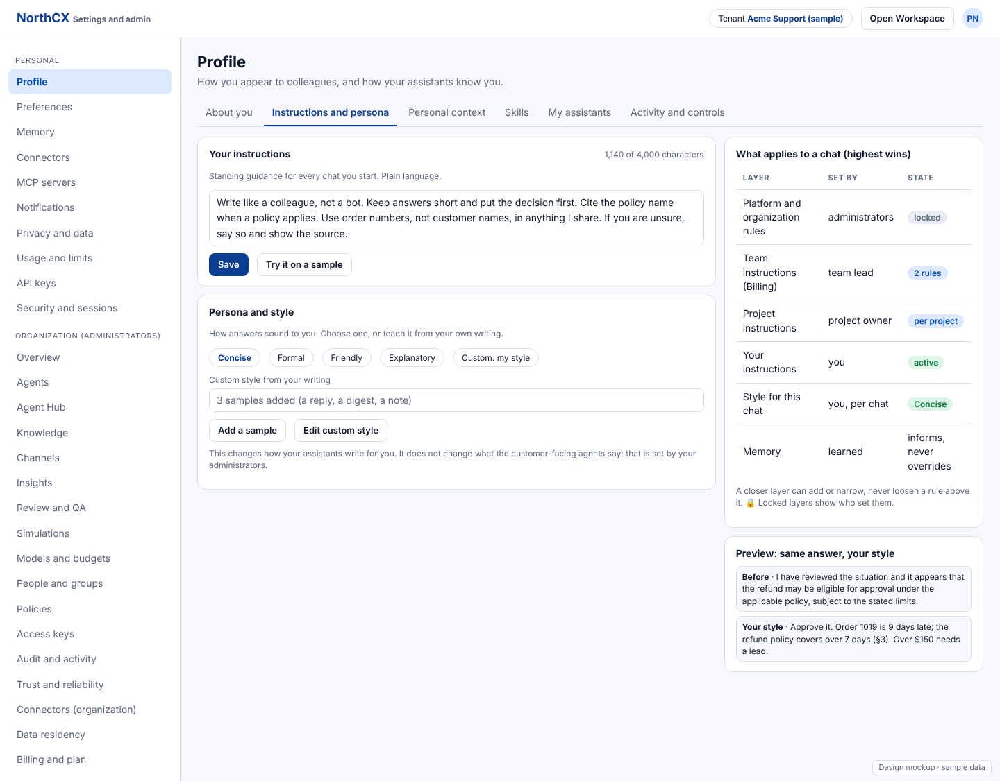 |
| **Personal context** | An opt-in switch, the sources an assistant may use (my hand-offs and approvals, my drafts and artifacts, my calendar, team playbooks, my email if connected), what it does with them (daily briefing, next-step suggestions, approval reminders, learning my reply style), with a briefing preview and "based on" sources | 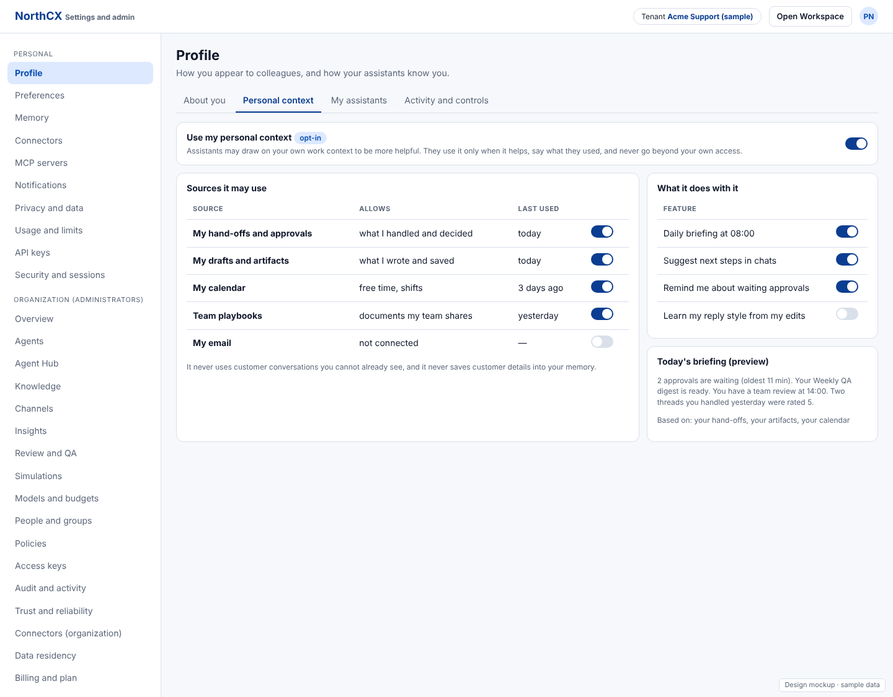 |
| **Skills** | Reusable ways of doing a task, loaded only when a chat needs them; sources: yours, your team's, your organization's (organization skills cannot be switched off); edit steps and the knowledge a skill points to; try it; share with a reviewer. A skill gives instructions, never new tools or access | 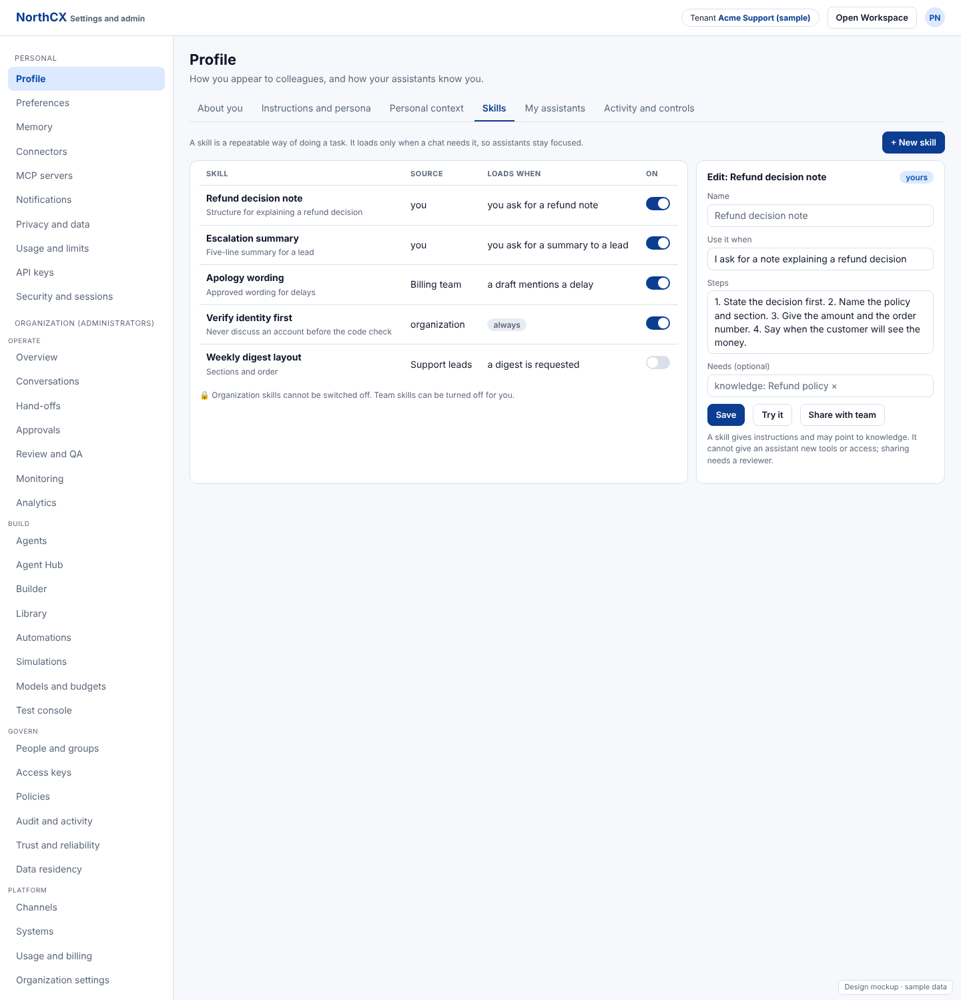 |
| **My assistants** | Assistants the person builds for their own work (name, what it does, knowledge it may use, tools, who can use it), shared with a team when ready, tried before saving |  |
| **Activity and controls** | What assistants used in the last seven days and for what, chat retention, temporary (unsaved) chat, export, delete chats, turn off and erase personal context | 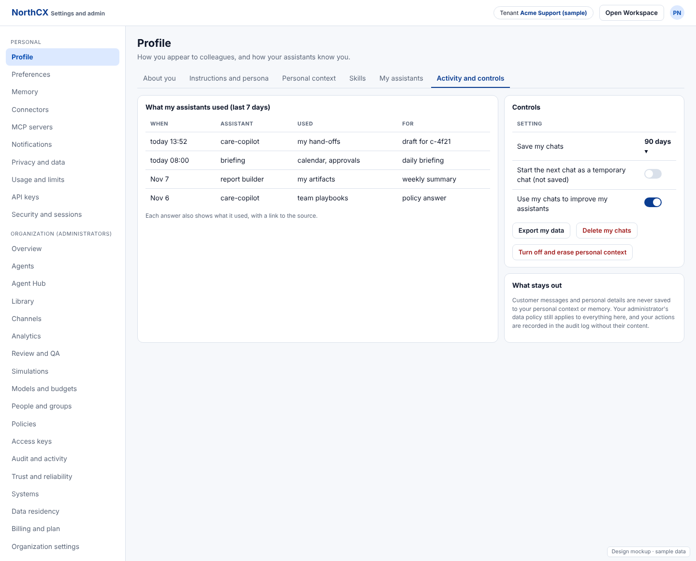 |

Rules: **opt-in and off until chosen**; the person picks each source; assistants use context only when it helps and **say what they used**, linking the source; it never reaches beyond the person's own access (an assistant they build can use only tools and knowledge they can use); **customer messages and personal details are never saved** to personal context or memory; chats can be temporary; the person can see, export and erase everything; administrators can switch personal context off for a team through policy (locked, with the lock shown); actions are audited without their content. Memory (the existing page) stays the place to read and edit saved notes.
**Layers and precedence (applies to instructions, persona, memory and skills).** From highest to lowest: platform and organization rules (locked, set by administrators) > team instructions > project instructions > the person's instructions > the style chosen for this chat; **memory informs but never overrides** instructions, and nothing overrides a policy, a source's facts or a customer's data. A closer layer may add or narrow, never loosen. The screen shows each layer, who set it and which are locked. Memory (its own page) has automatic and "remember this" saving, scopes (personal, project, team), where each memory came from and what it applies to, a switch to start a chat without memory, review prompts for unused items, and a note that memory must not make an assistant simply agree: assistants still cite sources and say when a source disagrees with a remembered preference.

**Theme and preferences** (Preferences page, follows the person across both windows): theme (light, dark, match my device), accent colour with status colours fixed in every theme, density, text size, navigation expanded or icons only, accessibility (high contrast, reduce motion, always show focus, screen-reader friendly tables), chat defaults (model mode, send key, show sources, show which model answered), language, date and time. 

Persona and style change how an assistant writes for the person; they never change what customer-facing agents say, which administrators control. Backend reality: the skills mechanism exists for agents (strict skills loaded from files, pinned into agent specs); personal instructions, styles, personal and project memory, personal skills and preferences storage are new (E5.5, E5). Preferences such as theme only need a small per-person settings store.

Backend reality: personal memory for staff, personal assistants (reusing the agent spec with an owner and a sharing scope), personal context sources and the briefing are new (E5.5 for staff and team memory, E5 for the staff assistant runtime, E8 for the scheduled briefing). Customer-facing memory with recall, edit and erase exists today.

Decisions: (1) which sources are allowed at first (recommended: hand-offs, approvals, drafts and artifacts, team documents; calendar and email later); (2) whether personal assistants may be shared without a reviewer when they can only read (recommended yes); (3) default retention of personal chats (90 days is the placeholder).

## 0f. Builder (proposal, 2026-11-09)
A **Builder** tab in the Admin Build group (next to Agents, Agent Hub, Knowledge and Simulations): an assistant that drafts and maintains agents. The owner agreed to list it as a proposed tab; the name and scope are still to be decided.

**Exists today:** draft an agent from procedures, a policy or a recording; refine an agent; draft test scenarios; draft and test journeys; transcribe a recording (API: `/v1/builder/draft`, `/refine`, `/scenarios`, `/transcribe`, and per-agent journey drafts). Drafts are validated, personal data is masked first, the model cannot set its own model, limits, voice, attachments, routes or tool scopes, and a draft is only ever a version that goes live through a release.

**Missing:** the improvement loop (investigate a failure, propose a spec change as a diff, run the required scenarios and a replay of past conversations, hand the result to a reviewer in one place; see the "Improve an agent" screen), proactive suggestions from failures and knowledge gaps, one conversation for investigating, editing and testing with changes held in a session until reviewed, and (later) presence in chat tools.

**Safety:** cannot release anything; acts with the permissions of the person using it (needs the right to create versions); reads only masked conversations and those reads are audited; every proposal shows what it looked at; spend, steps and time are capped per session with a kill switch. In the Workspace it appears only as small prompts (for example "Ask the builder to improve this agent" on a hand-off), not as a tab.

**Decisions:** (1) the name (Builder or another); (2) first release scope: drafting and refining with a proper screen, or also the improvement loop; (3) proactive suggestions on by default or opt-in per team; (4) chat-tool presence later (recommended).

## 0g. Workspace tab names and the Pilot window (owner-approved names, 2026-11-09)
**Final Workspace tab names** (replacing the earlier ones): Work: **Inbox** (was Threads), **Approvals**, **Customers**; Assist: **Pilot** (was Chat), **Assistants**, **Search**, **Library** (was Knowledge); Create: **Outputs** (was Artifacts), **Spaces** (was Projects), **Automations** (was Workflows and Scheduled, merged; Recurring is a filter); Team (leads and reviewers): **Quality** (was Reviews), **Performance** (was Insights); plus Home and Settings. Earlier sections of this document use the old names; the mockups were regenerated with the new ones.

**Assistants versus Pilot.** Assistants is the catalog of predefined staff assistants your organization made available (from the Agent Hub); Pilot is the conversation where you give one a task. "Agent" means the customer-facing AI; "assistant" means the staff-facing helper.

**The Pilot window.** Left: the Workspace navigation with recent chats. Centre: the conversation and a composer. Right: a panel with inner tabs **Plan, Output, Files, Sources, Context, Steps, Side chat**. The composer has a **+ menu** (space, files, Library sources, a conversation or customer as masked context, connected systems, skills and playbooks, pasted link or screenshot), a **task style** (Quick answer, Think, Research, Do) and a **model mode** (Auto, Faster, Best quality, Private only). Research and Do show a plan first, with clarifying questions, an estimate of time and cost, and "Approve and run" or "Run in background"; the Steps tab shows a live run with pause, redirect and stop, and the run can be replayed later; steps that write anything stop and ask first. Files are checked before the assistant sees them (a scan without text is refused with a reason; a PDF is read as text with personal data masked), and spaces carry their own instructions, files, sources and memory.

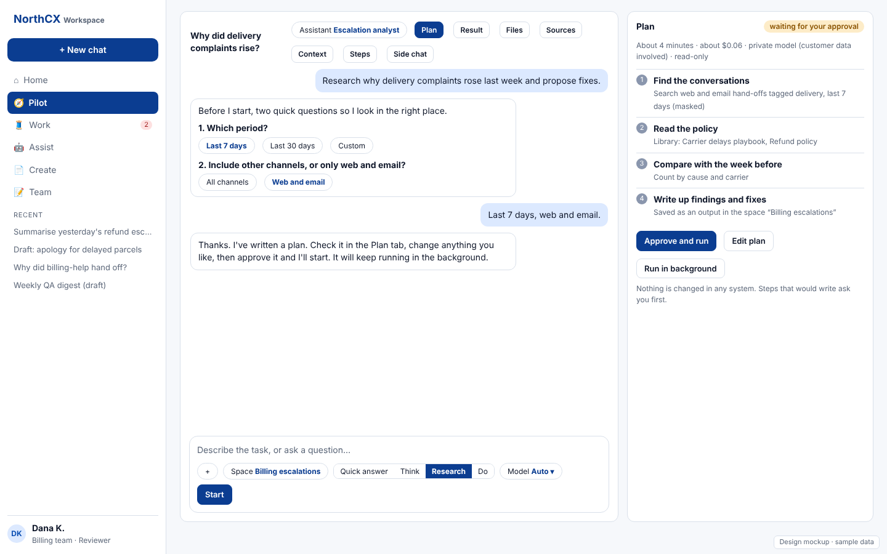

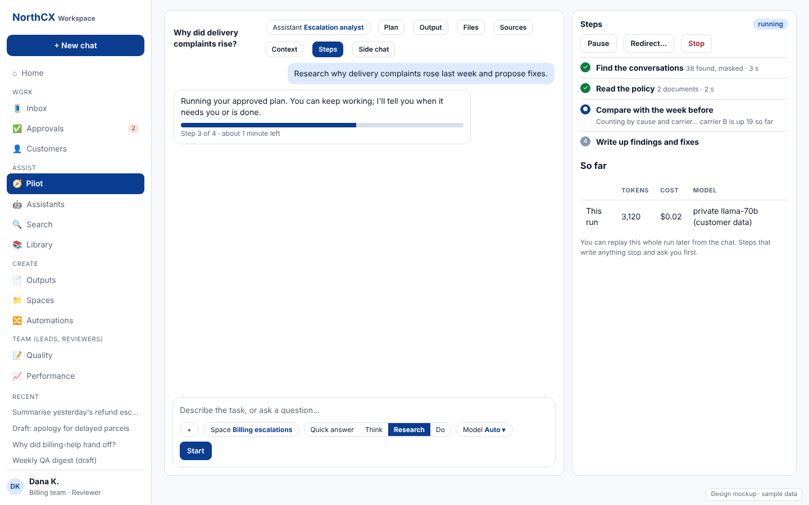

Backend reality: streaming chat with citations, approvals, traces and knowledge search exist; staff assistants with tools, spaces with files and memory, masked conversation attach and chat history need the staff backend (E5); the Output tab needs E6; background runs, schedule and automations need E8; the model mode needs the hybrid selection work. Decisions open: whether to start with all four task styles or Quick answer and Research only; whether the plan shows for every Research and Do task or on request; pause and redirect in the first version or later; a per-space file limit set by administrators.

## 1. Who uses what

One sign-in and one design system. **Admin platform** (today's Studio, extended) is for administrators, release managers, developers, reviewers and auditors. The **staff workspace** is a separate app for support staff and team leads, because its audience, speed needs and permissions differ. Developer portal, ops console and back office come later and are only drawn here as boxes.

## 1a. Together or separate: what other platforms do
Per the project rule, other companies' products are named only in `00-reference/NorthCX_Feature-Research-2026-11.md` (sections 7 to 9, with sources). Evidence is thin (product pages and third-party write-ups, no interface captures), so this is a pattern, not a measurement.

The pattern across employee AI workspaces, customer-service agent platforms, enterprise chat products and coding-agent workbenches: **people who do the work and people who govern the system get different surfaces**, tied together by one identity and a shared look. One customer-service helpdesk keeps both in a single app because its staff are the same people who configure the agent; the rest separate them. Working surfaces share one layout: threads on the left with status, the conversation in the middle, the work product on the right, several threads open at once. Administration is separate, off by default for risky capabilities, switched on per scope, and inherited from a higher level that lower levels cannot override. Two ideas carry into the design: parallel threads with visible status in the workspace queue, and every admin setting showing where it comes from and whether it is locked from above.

**Recommendation for NorthCX:** separate windows (separate addresses and navigation) with one sign-in, one design system and deep links between them. The staff workspace is its own app because its audience works all day in one queue, needs speed and a narrow permission set, and should never show configuration. The admin platform (Studio, extended) holds operate, build, govern and platform items for the people who configure and oversee agents. Small cross-links keep them feeling like one product: "Open in workspace" from a hand-off, "Open in admin" from an agent. A person with both roles gets an app switcher in the top bar.

### How the two windows look together
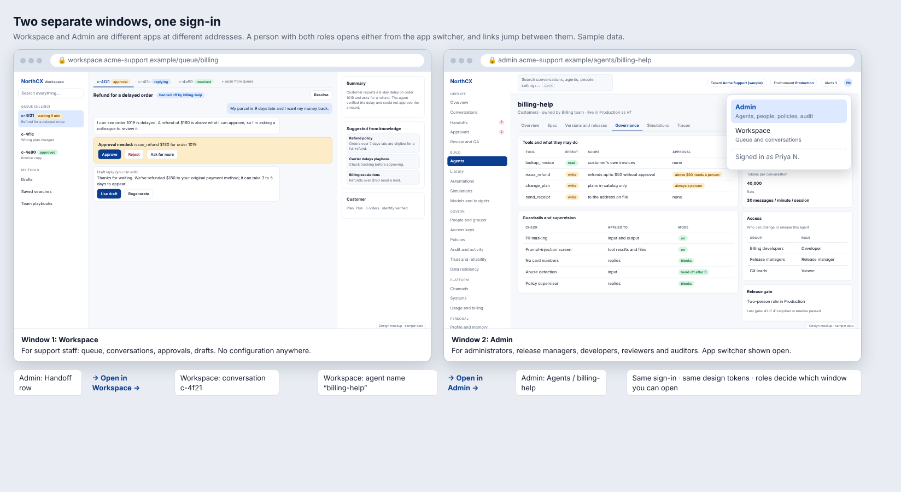
Two browser windows at different addresses, one sign-in. The app switcher (shown open in the Admin window) appears only for people who hold roles for both. Links jump across: a hand-off row in Admin opens the conversation in Workspace; an agent name in Workspace opens that agent in Admin.

## 2. Navigation (admin platform)

Four groups replace today's flat list of 14 items. Items a role cannot use are hidden, not greyed out.

| Group | Items | Today in Studio |
|---|---|---|
| **Operate** | Overview, Conversations, Handoffs, Approvals, Review and QA | All exist as separate pages; Overview is four counters |
| **Build** | Agents (catalog), Knowledge, Simulations, Models and budgets | Agents, Knowledge, Simulations exist; Models and budgets is new |
| **Govern** | People and groups, Access keys, Policies, Audit and activity | Keys and audit exist on one page; the rest are new |
| **Platform** | Connectors and MCP, Usage and cost, Data residency, Settings | Residency and Settings exist; the rest are new |

Top bar on every page: global search (Ctrl K), tenant switcher (appears once multi-tenancy exists; hidden for single-company installs), environment switcher, alerts, account menu.

## 3. Screens

### Overview: what needs attention

Answers "what do I do first": alerts, approvals waiting, budget warnings, expiring keys, sync problems, each with one button. Health per agent, channel mix, spend by team, recent changes. Uses existing insights, alerts, approvals and audit data; spend by team needs E1.6 and WP3.6.

### Agent catalog and governance

The catalog adds owner, purpose, team, model, release state, tool count (and how many write), cost and health. The governance tab shows what the agent may do (each tool's effect, scope and approval rule), its guardrails, limits and budget, who can change or release it, and the release gate. Tools, guardrails and gates exist in the backend; owner, purpose and team are new spec fields; per-agent budget and group access depend on WP1.6 and WP3.2.

### People and groups

Provisioned from the identity provider (SCIM); roles come from group bindings, effective permissions are the union. Deactivation ends sessions and revokes keys in one step. Backend is WP3.2 and WP3.3; nothing exists today beyond SSO group-to-role mapping.

### Access keys (scoped)

Keys limited to named agents and environments, with expiry and last-used. A drawer holds the create form so the list stays in view. Keys exist today; scoping is WP3.1.

### Models and budgets
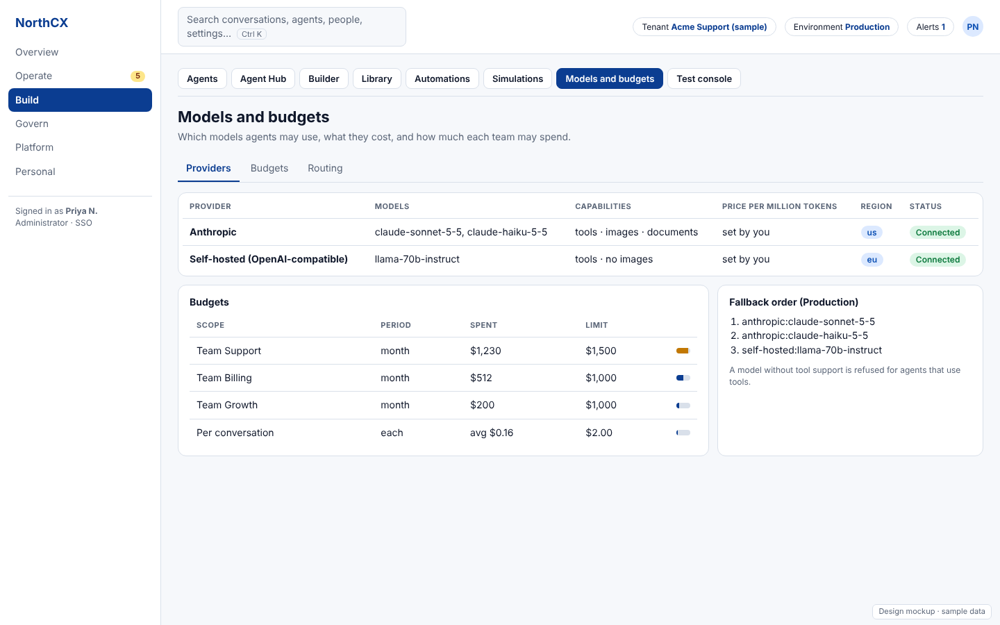
Providers with capabilities and operator-set prices, budgets per team and per conversation in currency, fallback order, and a refusal for a model that cannot call tools. Backend is E1 (WP1.3 to WP1.6).

### Audit and activity
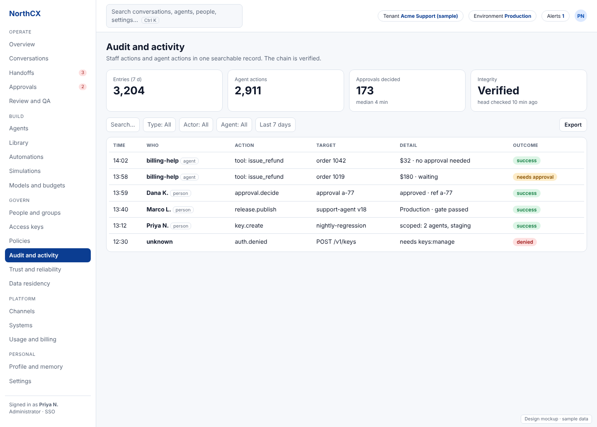
Staff actions and agent actions in one searchable record, with the approval reference on agent actions and the integrity status of the hash chain. The audit log exists; agent-action records are a new, medium-sized addition.

### Connectors and MCP
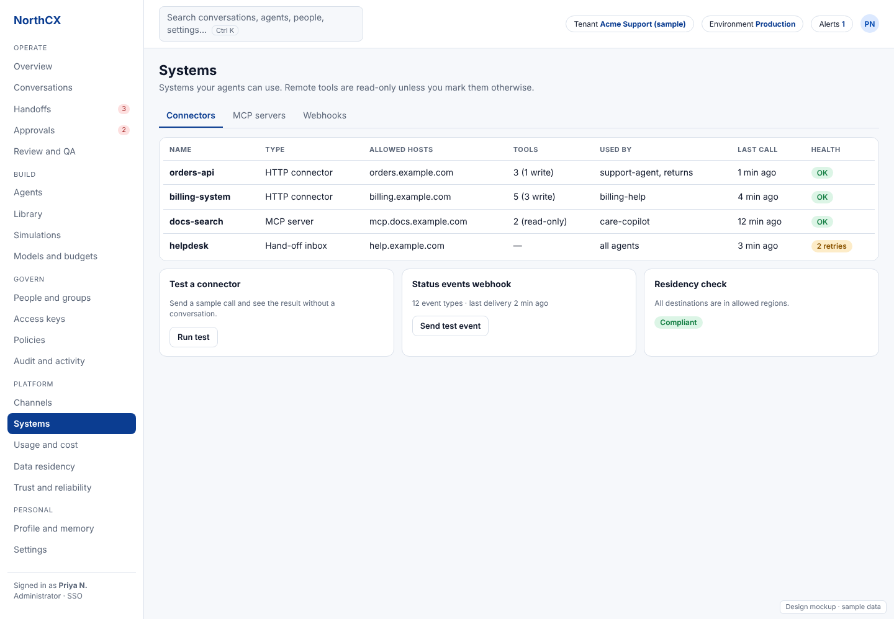
Every external system an agent can use, with allowed hosts, tools (and which write), who uses it, health, a test button and the events-webhook test (built in WP0.8). Connectors exist as files today; the screen and MCP are new (E4).

### Review and QA
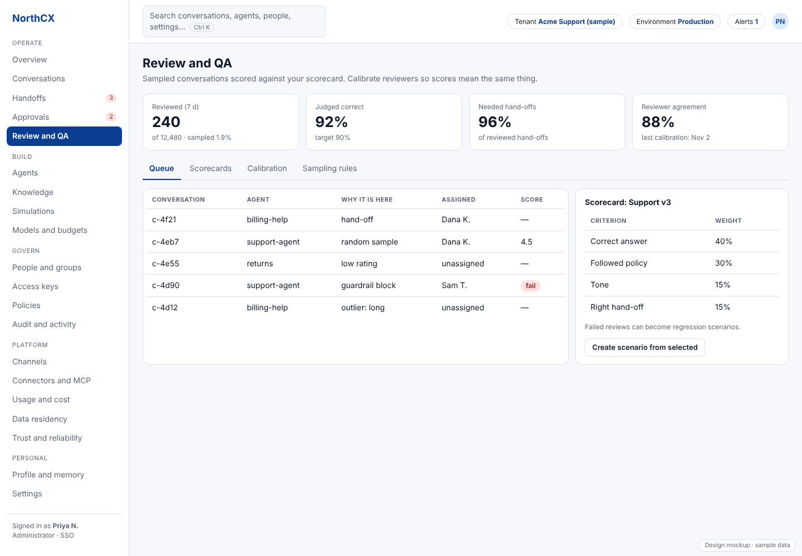
A queue built from hand-offs, low ratings, guardrail blocks, outliers and random samples, scorecards, reviewer calibration and sampling rules; a failed review can become a regression scenario. Review and the judge exist; scorecards, calibration, sampling and assignment are E7.

### Policies (where each setting comes from)

Each setting shows its value, which level set it (platform, tenant, team, agent), whether it is locked from above and what it applies to. A lower level may be stricter, never looser. Backend: the existing settings are environment variables today; per-tenant and per-team settings come with E2 (WP2.5).

### Staff workspace, session-style variant

An alternative arrangement of the same window, taking the session-list idea from coding-agent workbenches: a thread list grouped by who needs to act (needs me, agent is handling, resolved today) with status and team filters; a title bar with buttons that open Conversation, Customer, Knowledge, Trace and a side chat; a details column (where it is, what the agent did, what is running, context use); and under the reply box a row with queue, **reply mode** (draft only, review before send, send), copilot and budget. Reply mode is the staff counterpart of the approval modes agents already have. This is a layout idea, not a copy of any product.

### Staff workspace

Three columns: queue, open conversations as tabs with their status, conversation with inline approval and an editable draft reply, and a side panel with a summary, knowledge suggestions and the customer's context. Backend is E5; hand-offs, approvals and knowledge search exist and are the first things it would use.

## 4. Components
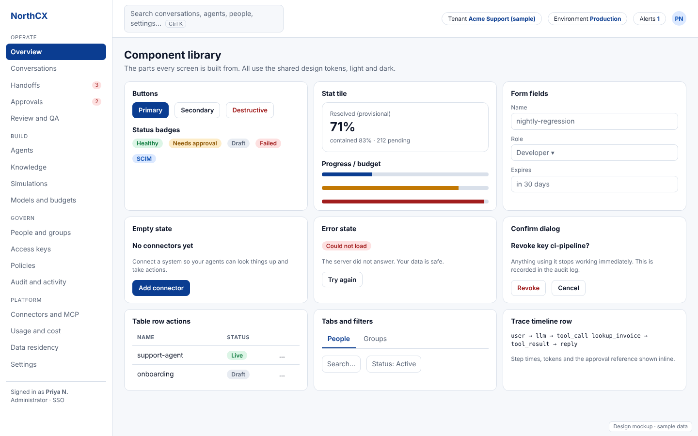
Buttons (primary, secondary, destructive), status badges, stat tiles, budget bars, tables with row actions, tabs and filters, form fields, drawers, empty, loading and error states, confirm dialogs, trace timeline. They use the shared design tokens (light and dark). Today `packages/ui` has states, status badge, trace timeline and answer charts; tables, drawers, filters, dialogs, tabs and stat tiles would be added there so every app shares them.

## 4a. Components of the two windows (decided: two separate apps)
Decision of 2026-11-09: the staff **Workspace** and the **Admin** platform are two separate apps with one sign-in and one design system. Today = exists in Studio or `packages/ui`; New = to build.

### Window 1: Workspace (`apps/workspace`, for support staff and team leads)
| Area | Components | Status |
|---|---|---|
| Frame | App header with search, status (available, away), notifications, account menu, app switcher | New |
| Left rail | Queue list (by team, with waiting time and priority), open-thread tabs with status (approval, replying, resolved), saved searches, drafts, team playbooks | New |
| Conversation | Message timeline (customer, agent, staff, system notes), hand-off banner with reason, inline approval card (approve, reject, ask for more), reply composer with draft reply, regenerate, attach, canned answers | Approval and hand-off data exist; the screen is New |
| Right panel | Conversation summary, suggested knowledge sources with the passage used, customer context (plan, orders, identity verified), conversation tags, related past conversations | New |
| Actions | Resolve, return to agent, transfer to queue or person, add note, set tag, flag for review | Hand-off resolve exists in the API |
| Search | One search across knowledge, conversations and hand-offs, with access applied per result | New (SearchProvider, E5) |
| Ask the copilot | Side chat with a staff agent (search, summarise, draft, report) | New (E5) |
| States | Empty queue, loading, error, offline banner, session expired | Partly in `packages/ui` |

### Window 2: Admin (`apps/studio`, extended, for administrators, release managers, developers, reviewers, auditors)
| Group | Pages and their components | Status |
|---|---|---|
| Frame | Grouped navigation, global search (Ctrl K), tenant and environment switchers, alerts bell, account menu, app switcher, role-aware hiding | Flat navigation exists; rest New |
| Operate | **Overview** (needs-attention list, stat tiles, agent health, channel mix, spend by team, recent changes); **Conversations** (search, filters, transcript, trace timeline); **Handoffs** (queue, detail, resolve); **Approvals** (list, decision, expiry); **Review and QA** (queue, scorecard form, calibration, sampling rules, create scenario from review) | Conversations, hand-offs, approvals, review exist as pages; Overview v2, scorecards, calibration, sampling New |
| Build | **Agents** (catalog table, spec editor, builder, versions and releases, rollout panel, governance tab); **Knowledge** (sources, documents, import, crawl and schedules, search test, indexing status); **Simulations** (scenarios, runs, scenario editor, gate status); **Models and budgets** (providers, prices, capabilities, budgets, fallback order, routing) | Agents, knowledge, simulations exist; catalog fields, governance tab, models and budgets New |
| Govern | **People and groups** (people, groups, role bindings, provisioning status); **Access keys** (list, scoped-key drawer, expiry, last used, revoke); **Policies** (setting table with source, lock and applies-to, change history); **Audit and activity** (filters, staff and agent actions, approval reference, integrity status, export) | Keys and audit exist on one page; the rest New |
| Platform | **Connectors and MCP** (connectors, MCP servers, webhooks, test buttons, health); **Usage and cost** (by agent, team, model, period; export); **Data residency** (destination report, policy); **Settings** (single sign-on, SCIM, session policy, alerts, retention, branding) | Residency, SSO, settings, alerts exist; connectors UI, usage and cost, SCIM New |

### Shared by both windows (`packages/ui` and `packages/api-client`)
| Kind | Components | Status |
|---|---|---|
| Layout | App frame, page header with actions, tabs, two-column and three-column layouts, drawer, modal, confirm dialog | New (frame, tabs, drawer, dialog) |
| Data | Data table (sort, filter, row actions, bulk select, pagination), stat tile, budget bar, ratio display, timeline, trace timeline, answer charts | Trace timeline and answer charts exist |
| Inputs | Text, select, multi-select chips, date range, toggle, key-value editor, search box with filters | New |
| Feedback | Status badge, toast, inline error, empty state, loading skeleton, error box with retry | Status badge, states exist |
| Policy | Setting row with source and lock, inherited-value indicator | New |
| Identity | Sign-in (SSO), session expiry, role gate, tenant switcher, app switcher | Role gate (`useMe`) exists |
| Foundations | Design tokens (light and dark), focus ring, spacing and type scale, icons | Tokens exist (WP0.2) |

## 5. Rules for every screen
Hide what the role cannot do; confirm before anything destructive and record it in the audit log; show an empty, loading and error state; keyboard and screen-reader support (labelled controls, visible focus, no colour-only status); no layout depends on hover; works at tablet width; every number says what it counts and over what period (the provisional resolution rate says so on the tile).

## 6. How I would build it
Vertical slices, each ending with backend, screens, tests and refreshed screenshots, in this order:

| Slice | Contents | Depends on |
|---|---|---|
| A | New shell (grouped navigation, top bar, global search, environment switcher), component library in `packages/ui`, Overview v2 | nothing new |
| B | Agent catalog and governance view, owner/purpose/team fields | small spec change |
| C | Scoped keys (WP3.1) and the audit and activity view with agent actions | WP3.1 |
| D | People, groups and role bindings (WP3.2), then SCIM (WP3.3) | WP3.1 |
| E | Models and budgets screens | E1 (WP1.3 to 1.6) |
| F | Connectors and MCP screens | E4 |
| G | Review and QA: scorecards, calibration, sampling | E7 |
| H | Staff workspace app (`apps/workspace`) | E5 and tenancy decisions |

## 7. Decisions needed
1. ~~One app or two for admin?~~ **Decided 2026-11-09: two separate apps, Workspace and Admin** (see 4a). Earlier question: The plan (decision #140) said Studio first, then separate admin, ops and back-office apps. I drew the admin platform as Studio extended, because the audience and sign-in are the same until multi-tenancy; splitting `apps/admin` out later is cheap because the shared parts are packages. Recommended: extend Studio now.
2. **Naming** of the staff product (open decision D2).
3. **Start with slice A**, or reorder?
4. Whether the mockups should also exist as a Figma file. The Figma connection was not available in this session, so these are HTML and PNG only.
