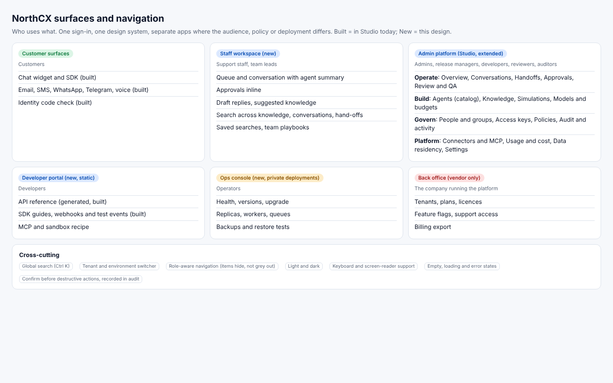
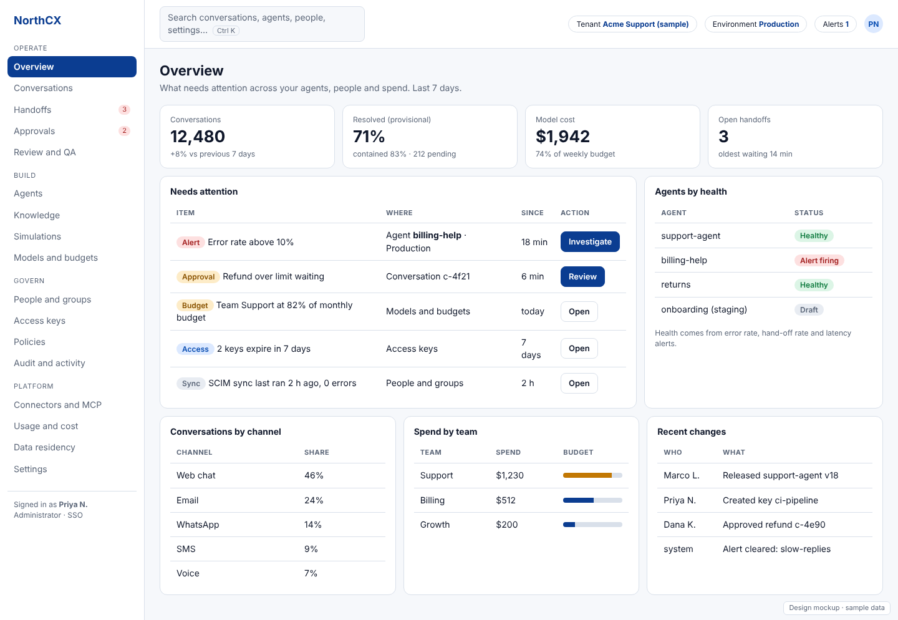
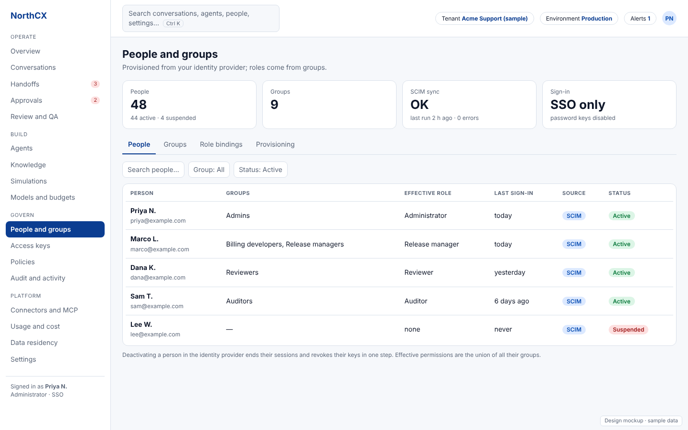

# NorthCX admin platform and staff workspace: design proposal

Status: **proposed** (2026-11-09). Nothing here is built yet except what the "Today" column says. The screens are static mockups with sample data (a company called "Acme Support" is invented for the pictures); they show intent, not working software. Sources: the current Studio, the implementation plan (E1, E3, E5, E7, E10), and the market research in `00-reference/NorthCX_Feature-Research-2026-11.md`.

Source files: `07-design/mockups/*.html` (regenerate with `python scripts/gen_design_mockups.py`, then `node scripts/shoot_mockups.js`). Images: `assets/design/`.

## 1. Who uses what

One sign-in and one design system. **Admin platform** (today's Studio, extended) is for administrators, release managers, developers, reviewers and auditors. The **staff workspace** is a separate app for support staff and team leads, because its audience, speed needs and permissions differ. Developer portal, ops console and back office come later and are only drawn here as boxes.

## 2. Navigation (admin platform)

Four groups replace today's flat list of 14 items. Items a role cannot use are hidden, not greyed out.

| Group | Items | Today in Studio |
|---|---|---|
| **Operate** | Overview, Conversations, Handoffs, Approvals, Review and QA | All exist as separate pages; Overview is four counters |
| **Build** | Agents (catalog), Knowledge, Simulations, Models and budgets | Agents, Knowledge, Simulations exist; Models and budgets is new |
| **Govern** | People and groups, Access keys, Policies, Audit and activity | Keys and audit exist on one page; the rest are new |
| **Platform** | Connectors and MCP, Usage and cost, Data residency, Settings | Residency and Settings exist; the rest are new |

Top bar on every page: global search (Ctrl K), tenant switcher (appears once multi-tenancy exists; hidden for single-company installs), environment switcher, alerts, account menu.

## 3. Screens

### Overview: what needs attention

Answers "what do I do first": alerts, approvals waiting, budget warnings, expiring keys, sync problems, each with one button. Health per agent, channel mix, spend by team, recent changes. Uses existing insights, alerts, approvals and audit data; spend by team needs E1.6 and WP3.6.

### Agent catalog and governance

The catalog adds owner, purpose, team, model, release state, tool count (and how many write), cost and health. The governance tab shows what the agent may do (each tool's effect, scope and approval rule), its guardrails, limits and budget, who can change or release it, and the release gate. Tools, guardrails and gates exist in the backend; owner, purpose and team are new spec fields; per-agent budget and group access depend on WP1.6 and WP3.2.

### People and groups

Provisioned from the identity provider (SCIM); roles come from group bindings, effective permissions are the union. Deactivation ends sessions and revokes keys in one step. Backend is WP3.2 and WP3.3; nothing exists today beyond SSO group-to-role mapping.

### Access keys (scoped)

Keys limited to named agents and environments, with expiry and last-used. A drawer holds the create form so the list stays in view. Keys exist today; scoping is WP3.1.

### Models and budgets

Providers with capabilities and operator-set prices, budgets per team and per conversation in currency, fallback order, and a refusal for a model that cannot call tools. Backend is E1 (WP1.3 to WP1.6).

### Audit and activity

Staff actions and agent actions in one searchable record, with the approval reference on agent actions and the integrity status of the hash chain. The audit log exists; agent-action records are a new, medium-sized addition.

### Connectors and MCP

Every external system an agent can use, with allowed hosts, tools (and which write), who uses it, health, a test button and the events-webhook test (built in WP0.8). Connectors exist as files today; the screen and MCP are new (E4).

### Review and QA

A queue built from hand-offs, low ratings, guardrail blocks, outliers and random samples, scorecards, reviewer calibration and sampling rules; a failed review can become a regression scenario. Review and the judge exist; scorecards, calibration, sampling and assignment are E7.

### Staff workspace

Three columns: queue, conversation with inline approval and an editable draft reply, and a side panel with a summary, knowledge suggestions and the customer's context. Backend is E5; hand-offs, approvals and knowledge search exist and are the first things it would use.

## 4. Components

Buttons (primary, secondary, destructive), status badges, stat tiles, budget bars, tables with row actions, tabs and filters, form fields, drawers, empty, loading and error states, confirm dialogs, trace timeline. They use the shared design tokens (light and dark). Today `packages/ui` has states, status badge, trace timeline and answer charts; tables, drawers, filters, dialogs, tabs and stat tiles would be added there so every app shares them.

## 5. Rules for every screen
Hide what the role cannot do; confirm before anything destructive and record it in the audit log; show an empty, loading and error state; keyboard and screen-reader support (labelled controls, visible focus, no colour-only status); no layout depends on hover; works at tablet width; every number says what it counts and over what period (the provisional resolution rate says so on the tile).

## 6. How I would build it
Vertical slices, each ending with backend, screens, tests and refreshed screenshots, in this order:

| Slice | Contents | Depends on |
|---|---|---|
| A | New shell (grouped navigation, top bar, global search, environment switcher), component library in `packages/ui`, Overview v2 | nothing new |
| B | Agent catalog and governance view, owner/purpose/team fields | small spec change |
| C | Scoped keys (WP3.1) and the audit and activity view with agent actions | WP3.1 |
| D | People, groups and role bindings (WP3.2), then SCIM (WP3.3) | WP3.1 |
| E | Models and budgets screens | E1 (WP1.3 to 1.6) |
| F | Connectors and MCP screens | E4 |
| G | Review and QA: scorecards, calibration, sampling | E7 |
| H | Staff workspace app (`apps/workspace`) | E5 and tenancy decisions |

## 7. Decisions needed
1. **One app or two for admin?** The plan (decision #140) said Studio first, then separate admin, ops and back-office apps. I drew the admin platform as Studio extended, because the audience and sign-in are the same until multi-tenancy; splitting `apps/admin` out later is cheap because the shared parts are packages. Recommended: extend Studio now.
2. **Naming** of the staff product (open decision D2).
3. **Start with slice A**, or reorder?
4. Whether the mockups should also exist as a Figma file. The Figma connection was not available in this session, so these are HTML and PNG only.
