# NorthCX admin platform and staff workspace: design

Status: **Designed**. Updated: 2026-11-09. Master for: screen-by-screen notes for the Admin app (names and tab lists: NorthCX_Platform-Features-and-Tabs.md). Nothing here is built yet except what the "Today" column says. The screens are static mockups with sample data (a company called "Acme Support" is invented for the pictures); they show intent, not working software. Sources: the current Studio, the implementation plan (E1, E3, E5, E7, E10), and the market research in `00-reference/NorthCX_Feature-Research-2026-11.md`.

> **Names in this document (updated 2026-11-09).** Older sections were written before the names were final. Read them with this map. **Workspace:** Threads is Inbox; Chat is Pilot; Knowledge is Library; Artifacts is Outputs; Projects is Spaces; Workflows and Scheduled are Automations; Reviews is Quality; Insights is Performance. **Admin:** Knowledge is Library; Insights is Analytics; Connectors (organization) is Systems; Settings is Organization settings; Connectors and MCP is Systems (organization) and Connectors plus MCP servers (Personal); Usage and cost and Billing and plan are one page, Usage and billing; Builder and Automations are added to Build. **Navigation:** both apps now show a few left items with sub-tabs (six each); see `NorthCX_Platform-Features-and-Tabs.md`, which takes precedence over this document for names, tab lists and the status of each feature (decisions 153 to 176). The mockup images were regenerated with the final names.

Source files: `07-design/mockups/*.html` (regenerate with `python scripts/gen_design_mockups.py`, then `node scripts/shoot_mockups.js`). Images: `assets/design/`.

## 0. Layout decided on 2026-11-09 (supersedes the earlier arrangement where they differ)
The owner described the layout; the two windows are:

**Window 1, Workspace (the agent platform for staff).** Final names (decisions 153, 157, 162): six left items, Home, Pilot, Work (Inbox, Approvals, Customers), Assist (Assistants, Search, Library), Create (Outputs, Spaces, Automations) and Team (Quality, Performance), with a "New chat" button, recent chats and the signed-in person. The right side is the working space for the selected item. Some older mockups below were drawn before the names were final; their sidebars have been regenerated with the six items.

| Left item or tab | What it is | Mockup |
|---|---|---|
| Home | What needs you, what is ready, recent work, a prompt | 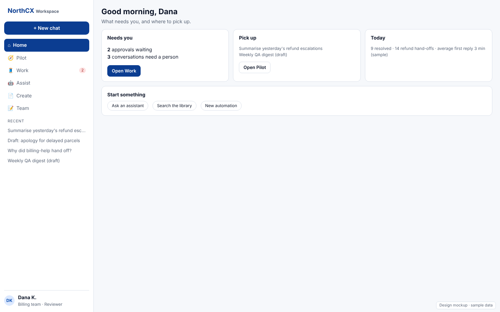 |
| Pilot | Give an assistant a task: clarifying questions, a plan to approve, live steps, a cited result |   |
| Work: Inbox | Customer conversations: needs me, agent is handling, resolved; reply and resolve with a note | 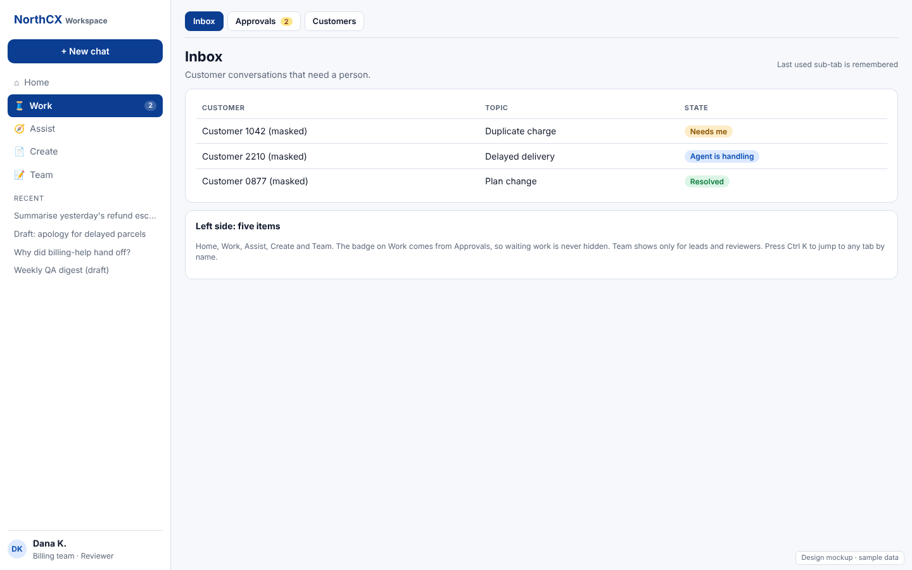  |
| Work: Customers | One customer across channels (second release) | 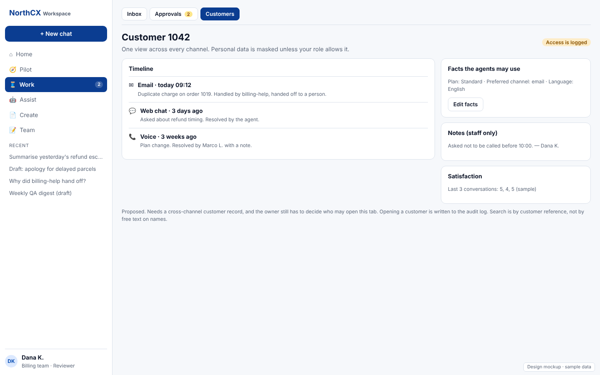 |
| Assist: Assistants | The assistants this person may use: search, favourites, what each can see and do, start a task | 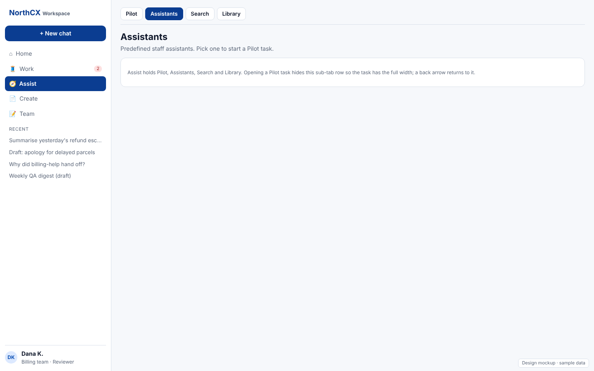 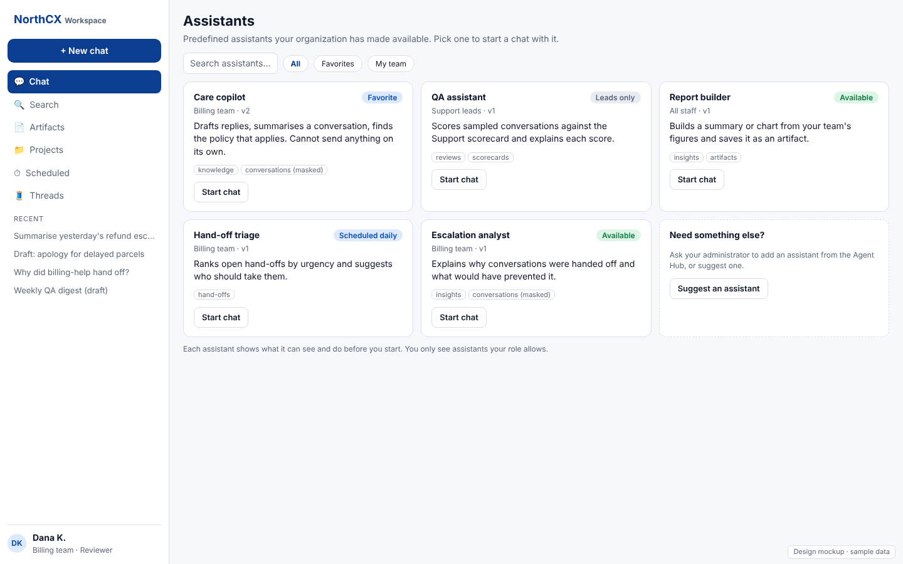 |
| Assist: Search | One search across knowledge, conversations, hand-offs and outputs, with the access reason on each result | 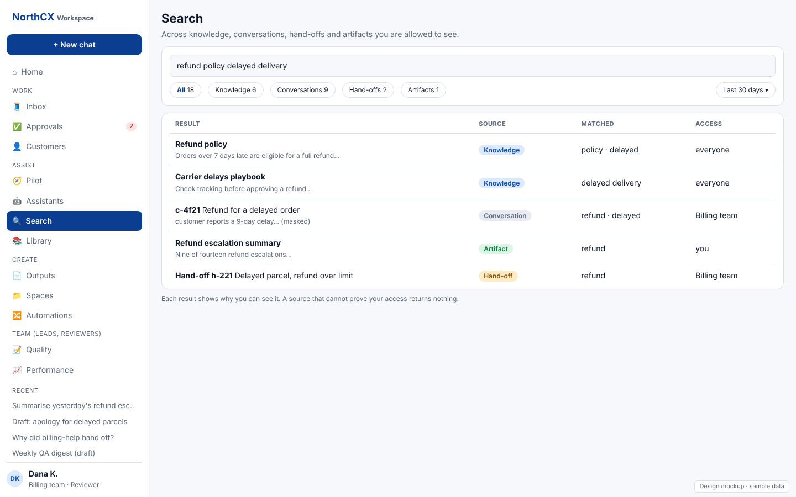 |
| Create: Outputs | Everything assistants made and the person saved: versions, share, schedule, export | 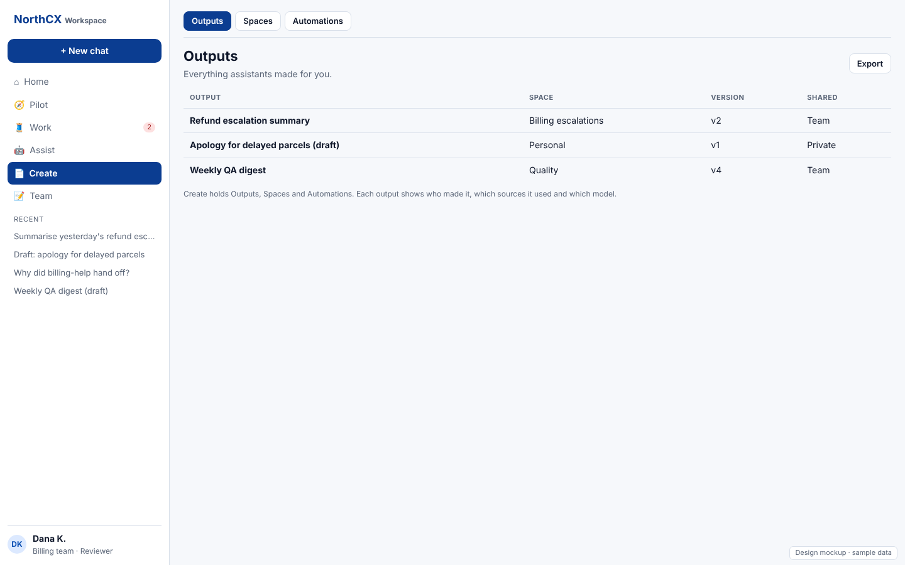 |
| Create: Spaces | Instructions, sources, chats and outputs for one piece of work (team or private) |  |
| Create: Automations | Work that runs by itself: triggers, steps, run history |  |
| Team: Quality, Performance | Review and coach; personal and team figures (leads and reviewers) | 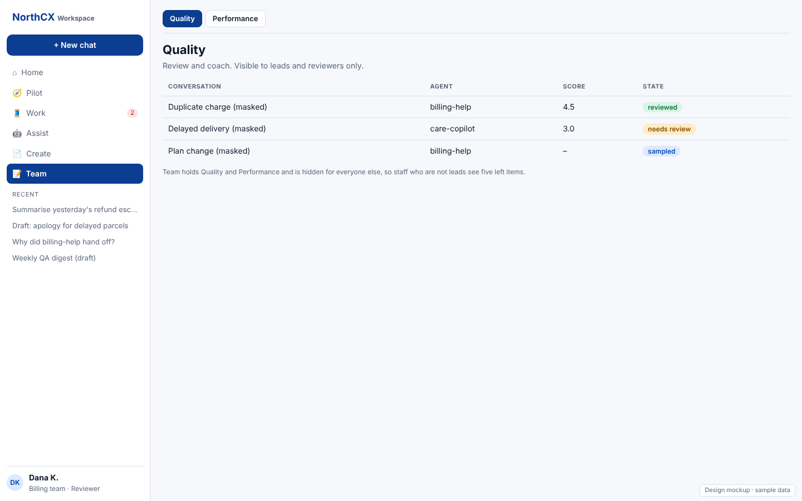 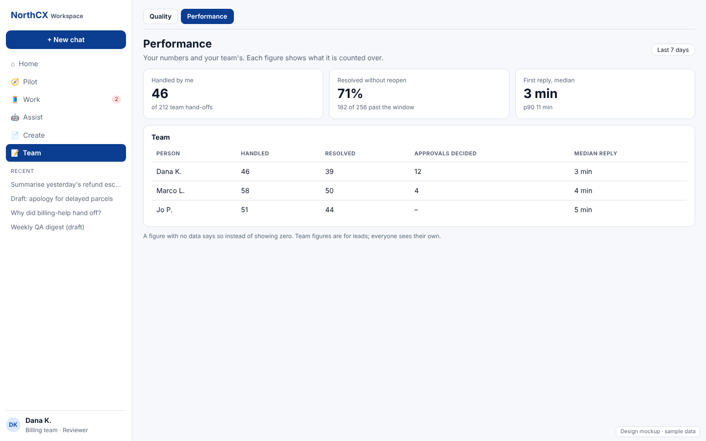 |

**Window 2, Settings and admin (the admin platform).** A wide settings app opened from the profile menu. Since decision 168 its left side shows six items with sub-tabs (Overview, Operate, Build, Govern, Platform, Personal). Earlier description: **Personal** options (Profile, Preferences, Memory, Connectors, MCP servers, Notifications, Privacy and data, Usage and limits, API keys, Security and sessions) and an **Organization (administrators)** group (People and groups, Agents, Models and budgets, Policies, Access, Audit and activity, Connectors (organization), Data residency, Billing and plan). Everyone sees the Personal group; the Organization group appears only for roles that can use it. The organization pages are the admin screens drawn earlier (sections 3 and below).

| Option | What it holds | Mockup |
|---|---|---|
| Profile | Name, team, language, time zone, default assistant, reply style, signature; roles shown read-only |  |
| Memory | What assistants remember: read, edit, erase, export; personal and team; on/off | 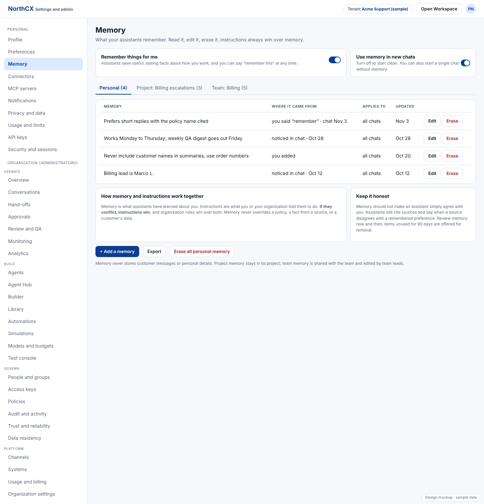 |
| Connectors and MCP servers | Connect systems, see scopes, enable or disable individual tools; remote tools write-by-default and approval-gated; organization policy can lock third-party servers |  |

What exists today for these: memory (with recall, edit and erase APIs for customers; staff and team memory are E5.5), connectors from files (no screens), MCP is not built (E4), scheduled tasks exist only for knowledge re-crawls (E8 is the automation work), outputs and spaces do not exist (E6, E5). The earlier three-column and session-style Workspace mockups (09, 15) remain as variants for the Inbox page.

Sections 0a to 0f (the design rounds of 2026-11-09 with their earlier names) are in `../99-archive/NorthCX_Admin-Design-History.md`.

## 0g. Workspace tab names and the Pilot window (owner-approved names, 2026-11-09)
**Final Workspace tab names** (replacing the earlier ones): Work: **Inbox** (was Threads), **Approvals**, **Customers**; Assist: **Pilot** (was Chat), **Assistants**, **Search**, **Library** (was Knowledge); Create: **Outputs** (was Artifacts), **Spaces** (was Projects), **Automations** (was Workflows and Scheduled, merged; Recurring is a filter); Team (leads and reviewers): **Quality** (was Reviews), **Performance** (was Insights); plus Home and Settings. Earlier sections of this document use the old names; the mockups were regenerated with the new ones.

**Assistants versus Pilot.** Assistants is the catalog of predefined staff assistants your organization made available (from the Agent Hub); Pilot is the conversation where you give one a task. "Agent" means the customer-facing AI; "assistant" means the staff-facing helper.

**The Pilot window.** Left: the Workspace navigation with recent chats. Centre: the conversation and a composer. Right: a panel with inner tabs **Plan, Result, Files, Sources, Context, Steps, Side chat**. The composer has a **+ menu** (space, files, Library sources, a conversation or customer as masked context, connected systems, skills and playbooks, pasted link or screenshot), a **task style** (Quick answer, Think, Research, Do) and a **model mode** (Auto, Faster, Best quality, Private only). Research and Do show a plan first, with clarifying questions, an estimate of time and cost, and "Approve and run" or "Run in background"; the Steps tab shows a live run with pause and stop (redirect in the second version), and the run can be replayed later; steps that write anything stop and ask first. Files are checked before the assistant sees them (a scan without text is refused with a reason; a PDF is read as text with personal data masked), and spaces carry their own instructions, files, sources and memory.

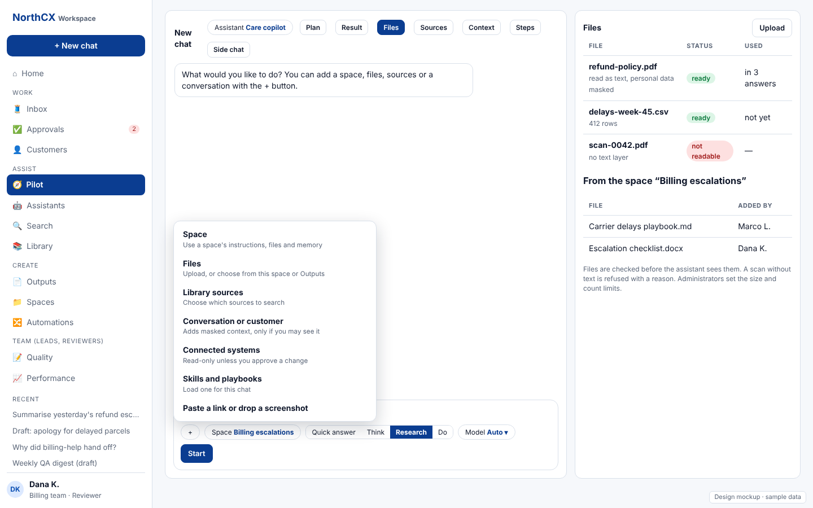

Backend reality: streaming chat with citations, approvals, traces and knowledge search exist; staff assistants with tools, spaces with files and memory, masked conversation attach and chat history need the staff backend (E5); the Result tab needs E6; background runs, schedule and automations need E8; the model mode needs the hybrid selection work. Decided (decision 163): Quick answer and Research first, Think and Do later; the plan shows for Research and Do only; pause and stop first, redirect second; file limits set per space by an administrator.

## 1. Who uses what

One sign-in and one design system. **Admin platform** (today's Studio, extended) is for administrators, release managers, developers, reviewers and auditors. The **staff workspace** is a separate app for support staff and team leads, because its audience, speed needs and permissions differ. Developer portal, ops console and back office come later and are only drawn here as boxes.

## 1a. Together or separate: what other platforms do
Per the project rule, other companies' products are named only in `00-reference/NorthCX_Feature-Research-2026-11.md` (sections 7 to 9, with sources). Evidence is thin (product pages and third-party write-ups, no interface captures), so this is a pattern, not a measurement.

The pattern across employee AI workspaces, customer-service agent platforms, enterprise chat products and coding-agent workbenches: **people who do the work and people who govern the system get different surfaces**, tied together by one identity and a shared look. One customer-service helpdesk keeps both in a single app because its staff are the same people who configure the agent; the rest separate them. Working surfaces share one layout: threads on the left with status, the conversation in the middle, the work product on the right, several threads open at once. Administration is separate, off by default for risky capabilities, switched on per scope, and inherited from a higher level that lower levels cannot override. Two ideas carry into the design: parallel threads with visible status in the workspace queue, and every admin setting showing where it comes from and whether it is locked from above.

**Recommendation for NorthCX:** separate windows (separate addresses and navigation) with one sign-in, one design system and deep links between them. The staff workspace is its own app because its audience works all day in one queue, needs speed and a narrow permission set, and should never show configuration. The admin platform (Studio, extended) holds operate, build, govern and platform items for the people who configure and oversee agents. Small cross-links keep them feeling like one product: "Open in workspace" from a hand-off, "Open in admin" from an agent. A person with both roles gets an app switcher in the top bar.

### How the two windows look together

Two browser windows at different addresses, one sign-in. The app switcher (shown open in the Admin window) appears only for people who hold roles for both. Links jump across: a hand-off row in Admin opens the conversation in Workspace; an agent name in Workspace opens that agent in Admin.

## 2. Navigation (admin platform)

Six left items with sub-tabs replace the 1.0 flat list of 14 items (decision 168): Overview, Operate, Build, Govern, Platform and Personal. Items a role cannot use are hidden, not greyed out. The organization pages:

| Group | Items | Today in Studio |
|---|---|---|
| **Overview** | (its own left item) | Exists; the 1.0 version shows five counters, a new version is early work |
| **Operate** | Conversations, Hand-offs, Approvals, Review and QA, Monitoring, Analytics | All exist as 1.0 pages (Analytics was called Insights) |
| **Build** | Agents (catalog), Agent Hub, Builder, Library, Automations, Simulations, Models and budgets, Test console | Agents, Library, Simulations and Test console exist; the others are new |
| **Govern** | People and groups, Access keys, Policies, Audit and activity, Trust and reliability, Data residency | Keys, audit and residency exist; the rest are new |
| **Platform** | Channels, Systems, Usage and billing, Organization settings | Residency (now under Govern) and Organization settings exist; the rest are new |

Top bar on every page: global search (Ctrl K), tenant switcher (appears once multi-tenancy exists; hidden for single-company installs), environment switcher, alerts, account menu.

## 3. Screens

### Overview: what needs attention

Answers "what do I do first": alerts, approvals waiting, budget warnings, expiring keys, sync problems, each with one button. Health per agent, channel mix, spend by team, recent changes. Uses existing insights, alerts, approvals and audit data; spend by team needs E1.6 and WP3.6.

### Agent catalog and governance
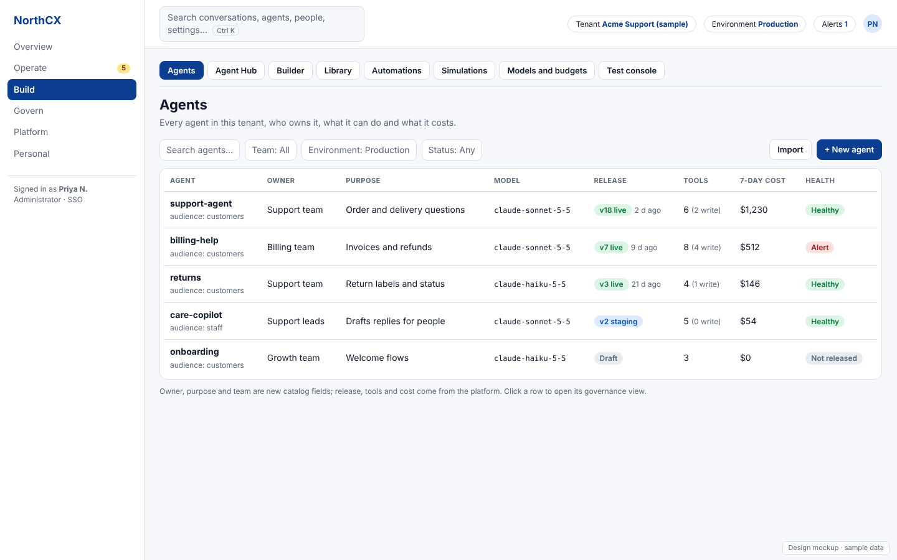

The catalog adds owner, purpose, team, model, release state, tool count (and how many write), cost and health. The governance tab shows what the agent may do (each tool's effect, scope and approval rule), its guardrails, limits and budget, who can change or release it, and the release gate. Tools, guardrails and gates exist in the backend; owner, purpose and team are new spec fields; per-agent budget and group access depend on WP1.6 and WP3.2.

### People and groups

Provisioned from the identity provider (SCIM); roles come from group bindings, effective permissions are the union. Deactivation ends sessions and revokes keys in one step. Backend is WP3.2 and WP3.3; nothing exists today beyond SSO group-to-role mapping.

### Access keys (scoped)

Keys limited to named agents and environments, with expiry and last-used. A drawer holds the create form so the list stays in view. Keys exist today; scoping is WP3.1.

### Models and budgets

Providers with capabilities and operator-set prices, budgets per team and per conversation in currency, fallback order, and a refusal for a model that cannot call tools. Backend is E1 (WP1.3 to WP1.6).

### Audit and activity

Staff actions and agent actions in one searchable record, with the approval reference on agent actions and the integrity status of the hash chain. The audit log exists; agent-action records are a new, medium-sized addition.

### Systems (organization; was "Connectors and MCP")

Every external system an agent can use, with allowed hosts, tools (and which write), who uses it, health, a test button and the events-webhook test (built in WP0.8). Connectors exist as files today; the screen and MCP are new (E4).

### Review and QA

A queue built from hand-offs, low ratings, guardrail blocks, outliers and random samples, scorecards, reviewer calibration and sampling rules; a failed review can become a regression scenario. Review and the judge exist; scorecards, calibration, sampling and assignment are E7.

### Policies (where each setting comes from)

Each setting shows its value, which level set it (platform, tenant, team, agent), whether it is locked from above and what it applies to. A lower level may be stricter, never looser. Backend: the existing settings are environment variables today; per-tenant and per-team settings come with E2 (WP2.5).

### Staff workspace, session-style variant

An alternative arrangement of the same window, taking the session-list idea from coding-agent workbenches: a thread list grouped by who needs to act (needs me, agent is handling, resolved today) with status and team filters; a title bar with buttons that open Conversation, Customer, Knowledge, Trace and a side chat; a details column (where it is, what the agent did, what is running, context use); and under the reply box a row with queue, **reply mode** (draft only, review before send, send), copilot and budget. Reply mode is the staff counterpart of the approval modes agents already have. This is a layout idea, not a copy of any product.

### Staff workspace

Three columns: queue, open conversations as tabs with their status, conversation with inline approval and an editable draft reply, and a side panel with a summary, knowledge suggestions and the customer's context. Backend is E5; hand-offs, approvals and knowledge search exist and are the first things it would use.

## 4. Components

Buttons (primary, secondary, destructive), status badges, stat tiles, budget bars, tables with row actions, tabs and filters, form fields, drawers, empty, loading and error states, confirm dialogs, trace timeline. They use the shared design tokens (light and dark). Today `packages/ui` has states, status badge, trace timeline and answer charts; tables, drawers, filters, dialogs, tabs and stat tiles would be added there so every app shares them.

## 4a. Components of the two windows (decided: two separate apps)
Decision of 2026-11-09: the staff **Workspace** and the **Admin** platform are two separate apps with one sign-in and one design system. Today = exists in Studio or `packages/ui`; New = to build. Early, unfinished code for some of these (the glass shell, a Workspace with a few pages) was merged to `main` on 2026-11-09 and is not counted as built here. The Workspace left rail follows the six left items (Home, Pilot, Work, Assist, Create, Team); the queue list below is the Inbox.

### Window 1: Workspace (`apps/workspace`, for support staff and team leads)
| Area | Components | Status |
|---|---|---|
| Frame | App header with search, status (available, away), notifications, account menu, app switcher | New |
| Left rail | Queue list (by team, with waiting time and priority), open-thread tabs with status (approval, replying, resolved), saved searches, drafts, team playbooks | New |
| Conversation | Message timeline (customer, agent, staff, system notes), hand-off banner with reason, inline approval card (approve, reject, ask for more), reply composer with draft reply, regenerate, attach, canned answers | Approval and hand-off data exist; the screen is New |
| Right panel | Conversation summary, suggested knowledge sources with the passage used, customer context (plan, orders, identity verified), conversation tags, related past conversations | New |
| Actions | Resolve, return to agent, transfer to queue or person, add note, set tag, flag for review | Hand-off resolve exists in the API |
| Search | One search across knowledge, conversations and hand-offs, with access applied per result | New (SearchProvider, E5) |
| Ask the copilot | Side chat with a staff agent (search, summarise, draft, report) | New (E5) |
| States | Empty queue, loading, error, offline banner, session expired | Partly in `packages/ui` |

### Window 2: Admin (`apps/studio`, extended, for administrators, release managers, developers, reviewers, auditors)
| Group | Pages and their components | Status |
|---|---|---|
| Frame | Six left items with sub-tabs (decision 168), global search (Ctrl K), tenant and environment switchers, alerts bell, account menu, app switcher, role-aware hiding | A grouped shell exists as early, unfinished code; the sub-tab layout and the rest are New |
| Overview and Operate | **Overview** (its own left item: needs-attention list, stat tiles, agent health, channel mix, spend by team, recent changes); **Conversations** (search, filters, transcript, trace timeline); **Hand-offs** (queue, detail, resolve); **Approvals** (list, decision, expiry); **Review and QA** (queue, scorecard form, calibration, sampling rules, create scenario from review); **Monitoring** (alerts, findings, delivery status); **Analytics** (figures with denominators, plain-language questions) | Conversations, hand-offs, approvals, review, monitoring and analytics exist as 1.0 pages; Overview v2, scorecards, calibration, sampling New |
| Build | **Agents** (catalog table, spec editor, versions and releases, rollout panel, governance tab); **Agent Hub** (browse, install wizard, updates, my organization); **Builder** (drafts, refine, improvement loop); **Library** (sources, documents, import, crawl and schedules, search test, indexing status); **Automations** (all workflows, publish review, kill switch); **Simulations** (scenarios, runs, scenario editor, gate status); **Models and budgets** (providers, prices, capabilities, budgets, fallback order, routing); **Test console** | Agents, Library, Simulations and Test console exist; drafting exists as API; catalog fields, governance tab, Agent Hub (early code), Builder screen, Automations, Models and budgets New |
| Govern | **People and groups** (people, groups, role bindings, provisioning status); **Access keys** (list, scoped-key drawer, expiry, last used, revoke); **Policies** (setting table with source, lock and applies-to, change history); **Audit and activity** (filters, staff and agent actions, approval reference, integrity status, export); **Trust and reliability** (guardrail blocks, supervisor interventions, adversarial-suite trend, what has not been done); **Data residency** (destination report, policy) | Keys and audit exist on one page; the rest New |
| Platform | **Systems** (outside systems, allowed hosts, tools, outbound events and the test sender, health); **Usage and billing** (spend by agent, team, model and period with export; plan and invoices); **Organization settings** (single sign-on, SCIM, session policy, alerts, retention, branding) | SSO, settings and alerts exist; the Systems screen, Usage and billing and SCIM New |

### Shared by both windows (`packages/ui` and `packages/api-client`)
| Kind | Components | Status |
|---|---|---|
| Layout | App frame, page header with actions, tabs, two-column and three-column layouts, drawer, modal, confirm dialog | New (frame, tabs, drawer, dialog) |
| Data | Data table (sort, filter, row actions, bulk select, pagination), stat tile, budget bar, ratio display, timeline, trace timeline, answer charts | Trace timeline and answer charts exist |
| Inputs | Text, select, multi-select chips, date range, toggle, key-value editor, search box with filters | New |
| Feedback | Status badge, toast, inline error, empty state, loading skeleton, error box with retry | Status badge, states exist |
| Policy | Setting row with source and lock, inherited-value indicator | New |
| Identity | Sign-in (SSO), session expiry, role gate, tenant switcher, app switcher | Role gate (`useMe`) exists |
| Foundations | Design tokens (light and dark), focus ring, spacing and type scale, icons | Tokens exist (WP0.2) |

## 5. Rules for every screen
Hide what the role cannot do; confirm before anything destructive and record it in the audit log; show an empty, loading and error state; keyboard and screen-reader support (labelled controls, visible focus, no colour-only status); no layout depends on hover; works at tablet width; every number says what it counts and over what period (the provisional resolution rate says so on the tile).

## 6. Build order (slices; planning only, nothing here is started)
Vertical slices, each ending with backend, screens, tests and refreshed screenshots, in this order:

| Slice | Contents | Depends on |
|---|---|---|
| A | New shell (six left items with sub-tabs, top bar, global search, environment switcher), component library in `packages/ui`, Overview v2 | nothing new (early shell code exists) |
| B | Agent catalog and governance view, owner/purpose/team fields | small spec change |
| C | Scoped keys (WP3.1) and the audit and activity view with agent actions | WP3.1 |
| D | People, groups and role bindings (WP3.2), then SCIM (WP3.3) | WP3.1 |
| E | Models and budgets screens | E1 (WP1.3 to 1.6) |
| F | Systems and MCP screens | E4 |
| G | Review and QA: scorecards, calibration, sampling | E7 |
| H | Staff workspace app (`apps/workspace`) | E5 and tenancy decisions |

## 7. Decisions (status 2026-11-09)
All decisions from this document are made except open versus commercial, the Explorer privacy question and formal acceptance of E22. See the decision log (153 to 176) and `NorthCX_Platform-Features-and-Tabs.md`.
1. **One app or two:** two separate apps, Workspace and Admin (decided; section 4a).
2. **Naming of the staff product (D2):** working name NorthCX Workspace (decision 170).
3. **Tabs and navigation:** six left items with sub-tabs in each app (decisions 157, 168); the first Workspace release is Inbox, Approvals, Pilot, Assistants, Search and Library (decision 162).
4. **Build order:** slice A first is the starting point once implementation begins; the order follows the implementation plan (E1, E2, E3, E5, E6, E22, E8).
5. **Figma:** the mockups are HTML and PNG; a Figma file has not been made.
6. **Still open:** D1, open versus commercial (blocks pricing).
