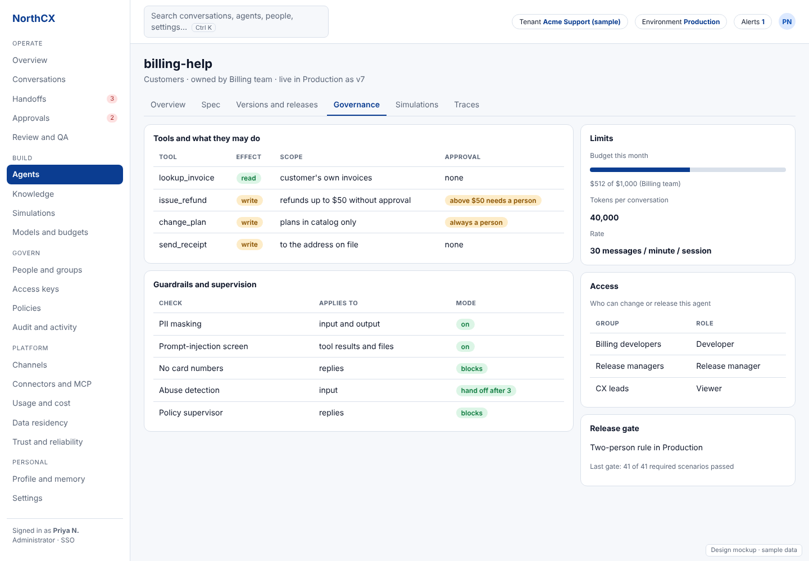
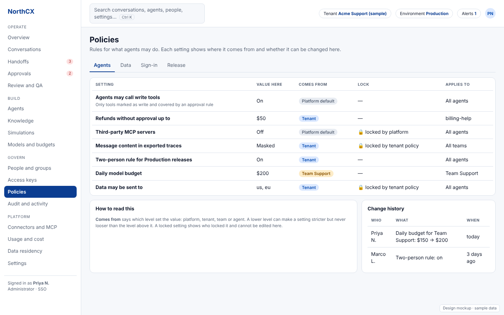
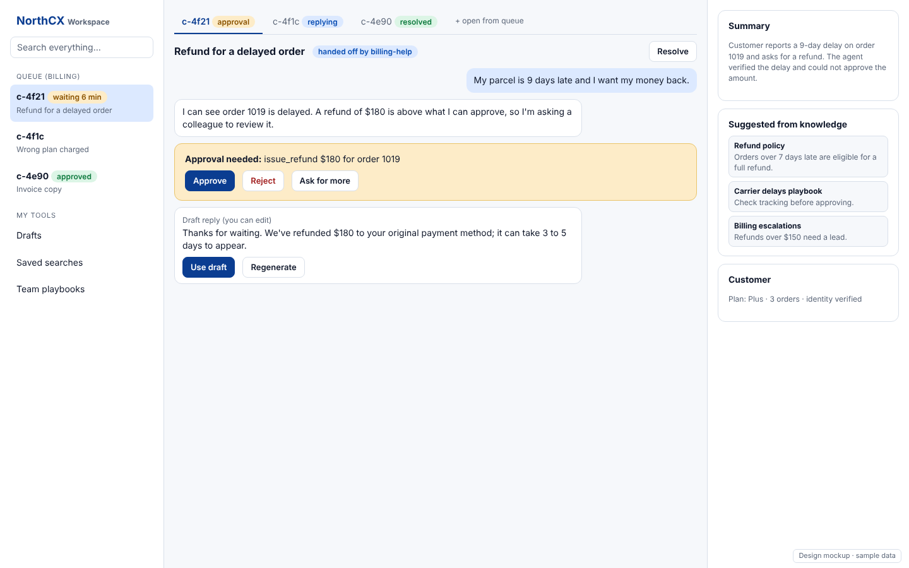

# NorthCX admin platform and staff workspace: design proposal

Status: **proposed** (2026-11-09). Nothing here is built yet except what the "Today" column says. The screens are static mockups with sample data (a company called "Acme Support" is invented for the pictures); they show intent, not working software. Sources: the current Studio, the implementation plan (E1, E3, E5, E7, E10), and the market research in `00-reference/NorthCX_Feature-Research-2026-11.md`.

Source files: `07-design/mockups/*.html` (regenerate with `python scripts/gen_design_mockups.py`, then `node scripts/shoot_mockups.js`). Images: `assets/design/`.

## 1. Who uses what

One sign-in and one design system. **Admin platform** (today's Studio, extended) is for administrators, release managers, developers, reviewers and auditors. The **staff workspace** is a separate app for support staff and team leads, because its audience, speed needs and permissions differ. Developer portal, ops console and back office come later and are only drawn here as boxes.

## 1a. Together or separate: what other platforms do
Evidence is thin (product pages and third-party write-ups, no screenshots of the interfaces), so this is a pattern, not a measurement. Details and sources are in `00-reference/NorthCX_Feature-Research-2026-11.md` section 7.

| Platform | How it splits the surfaces |
|---|---|
| Cohere North | An employee-facing workspace for chat, search and agents, and a separate management console (North Admin) for spending controls, security guardrails per agent and instance settings |
| Sierra | Agent Studio (build), Insights (analytics) and Live Assist (copilot for human reps) are presented as separate products under one platform |
| Intercom | One app, two areas: the Inbox where people work conversations (with a Fin folder and resolution-state views) and a Fin section for analysing, training, testing and deploying, with workspace-wide settings elsewhere |
| ChatGPT Enterprise, Microsoft 365 Copilot | A chat workspace for everyone and a separate admin console (users, SSO, usage, compliance) for administrators |

The pattern: **people who do the work and people who govern the system get different surfaces**, tied together by one identity and shared look. Where a vendor keeps both in one app (Intercom), it is a CX helpdesk whose staff are the same people who configure the agent.

Coding and general agent workbenches (Codex, the Claude Code desktop app, MiniMax's desktop app) share one working layout: threads on the left, the conversation in the middle, the work product on the right, several threads running in parallel; their administration (GitHub Copilot's policies pages, for example) is separate, default-off for risky capabilities, and inherited from a higher level. Two ideas carry into the design: parallel threads with visible status in the workspace queue, and every admin setting showing where it comes from and whether it is locked from above.

**Recommendation for NorthCX:** separate windows (separate addresses and navigation) with one sign-in, one design system and deep links between them. The staff workspace is its own app because its audience works all day in one queue, needs speed and a narrow permission set, and should never show configuration. The admin platform (Studio, extended) holds operate, build, govern and platform items for the people who configure and oversee agents. Small cross-links keep them feeling like one product: "Open in workspace" from a hand-off, "Open in admin" from an agent. A person with both roles gets an app switcher in the top bar.

## 2. Navigation (admin platform)

Four groups replace today's flat list of 14 items. Items a role cannot use are hidden, not greyed out.

| Group | Items | Today in Studio |
|---|---|---|
| **Operate** | Overview, Conversations, Handoffs, Approvals, Review and QA | All exist as separate pages; Overview is four counters |
| **Build** | Agents (catalog), Knowledge, Simulations, Models and budgets | Agents, Knowledge, Simulations exist; Models and budgets is new |
| **Govern** | People and groups, Access keys, Policies, Audit and activity | Keys and audit exist on one page; the rest are new |
| **Platform** | Connectors and MCP, Usage and cost, Data residency, Settings | Residency and Settings exist; the rest are new |

Top bar on every page: global search (Ctrl K), tenant switcher (appears once multi-tenancy exists; hidden for single-company installs), environment switcher, alerts, account menu.

## 3. Screens

### Overview: what needs attention

Answers "what do I do first": alerts, approvals waiting, budget warnings, expiring keys, sync problems, each with one button. Health per agent, channel mix, spend by team, recent changes. Uses existing insights, alerts, approvals and audit data; spend by team needs E1.6 and WP3.6.

### Agent catalog and governance

The catalog adds owner, purpose, team, model, release state, tool count (and how many write), cost and health. The governance tab shows what the agent may do (each tool's effect, scope and approval rule), its guardrails, limits and budget, who can change or release it, and the release gate. Tools, guardrails and gates exist in the backend; owner, purpose and team are new spec fields; per-agent budget and group access depend on WP1.6 and WP3.2.

### People and groups

Provisioned from the identity provider (SCIM); roles come from group bindings, effective permissions are the union. Deactivation ends sessions and revokes keys in one step. Backend is WP3.2 and WP3.3; nothing exists today beyond SSO group-to-role mapping.

### Access keys (scoped)

Keys limited to named agents and environments, with expiry and last-used. A drawer holds the create form so the list stays in view. Keys exist today; scoping is WP3.1.

### Models and budgets

Providers with capabilities and operator-set prices, budgets per team and per conversation in currency, fallback order, and a refusal for a model that cannot call tools. Backend is E1 (WP1.3 to WP1.6).

### Audit and activity

Staff actions and agent actions in one searchable record, with the approval reference on agent actions and the integrity status of the hash chain. The audit log exists; agent-action records are a new, medium-sized addition.

### Connectors and MCP

Every external system an agent can use, with allowed hosts, tools (and which write), who uses it, health, a test button and the events-webhook test (built in WP0.8). Connectors exist as files today; the screen and MCP are new (E4).

### Review and QA

A queue built from hand-offs, low ratings, guardrail blocks, outliers and random samples, scorecards, reviewer calibration and sampling rules; a failed review can become a regression scenario. Review and the judge exist; scorecards, calibration, sampling and assignment are E7.

### Policies (where each setting comes from)

Each setting shows its value, which level set it (platform, tenant, team, agent), whether it is locked from above and what it applies to. A lower level may be stricter, never looser. Backend: the existing settings are environment variables today; per-tenant and per-team settings come with E2 (WP2.5).

### Staff workspace

Three columns: queue, open conversations as tabs with their status, conversation with inline approval and an editable draft reply, and a side panel with a summary, knowledge suggestions and the customer's context. Backend is E5; hand-offs, approvals and knowledge search exist and are the first things it would use.

## 4. Components

Buttons (primary, secondary, destructive), status badges, stat tiles, budget bars, tables with row actions, tabs and filters, form fields, drawers, empty, loading and error states, confirm dialogs, trace timeline. They use the shared design tokens (light and dark). Today `packages/ui` has states, status badge, trace timeline and answer charts; tables, drawers, filters, dialogs, tabs and stat tiles would be added there so every app shares them.

## 4a. Components of the two windows (decided: two separate apps)
Decision of 2026-11-09: the staff **Workspace** and the **Admin** platform are two separate apps with one sign-in and one design system. Today = exists in Studio or `packages/ui`; New = to build.

### Window 1: Workspace (`apps/workspace`, for support staff and team leads)
| Area | Components | Status |
|---|---|---|
| Frame | App header with search, status (available, away), notifications, account menu, app switcher | New |
| Left rail | Queue list (by team, with waiting time and priority), open-thread tabs with status (approval, replying, resolved), saved searches, drafts, team playbooks | New |
| Conversation | Message timeline (customer, agent, staff, system notes), hand-off banner with reason, inline approval card (approve, reject, ask for more), reply composer with draft reply, regenerate, attach, canned answers | Approval and hand-off data exist; the screen is New |
| Right panel | Conversation summary, suggested knowledge sources with the passage used, customer context (plan, orders, identity verified), conversation tags, related past conversations | New |
| Actions | Resolve, return to agent, transfer to queue or person, add note, set tag, flag for review | Hand-off resolve exists in the API |
| Search | One search across knowledge, conversations and hand-offs, with access applied per result | New (SearchProvider, E5) |
| Ask the copilot | Side chat with a staff agent (search, summarise, draft, report) | New (E5) |
| States | Empty queue, loading, error, offline banner, session expired | Partly in `packages/ui` |

### Window 2: Admin (`apps/studio`, extended, for administrators, release managers, developers, reviewers, auditors)
| Group | Pages and their components | Status |
|---|---|---|
| Frame | Grouped navigation, global search (Ctrl K), tenant and environment switchers, alerts bell, account menu, app switcher, role-aware hiding | Flat navigation exists; rest New |
| Operate | **Overview** (needs-attention list, stat tiles, agent health, channel mix, spend by team, recent changes); **Conversations** (search, filters, transcript, trace timeline); **Handoffs** (queue, detail, resolve); **Approvals** (list, decision, expiry); **Review and QA** (queue, scorecard form, calibration, sampling rules, create scenario from review) | Conversations, hand-offs, approvals, review exist as pages; Overview v2, scorecards, calibration, sampling New |
| Build | **Agents** (catalog table, spec editor, builder, versions and releases, rollout panel, governance tab); **Knowledge** (sources, documents, import, crawl and schedules, search test, indexing status); **Simulations** (scenarios, runs, scenario editor, gate status); **Models and budgets** (providers, prices, capabilities, budgets, fallback order, routing) | Agents, knowledge, simulations exist; catalog fields, governance tab, models and budgets New |
| Govern | **People and groups** (people, groups, role bindings, provisioning status); **Access keys** (list, scoped-key drawer, expiry, last used, revoke); **Policies** (setting table with source, lock and applies-to, change history); **Audit and activity** (filters, staff and agent actions, approval reference, integrity status, export) | Keys and audit exist on one page; the rest New |
| Platform | **Connectors and MCP** (connectors, MCP servers, webhooks, test buttons, health); **Usage and cost** (by agent, team, model, period; export); **Data residency** (destination report, policy); **Settings** (single sign-on, SCIM, session policy, alerts, retention, branding) | Residency, SSO, settings, alerts exist; connectors UI, usage and cost, SCIM New |

### Shared by both windows (`packages/ui` and `packages/api-client`)
| Kind | Components | Status |
|---|---|---|
| Layout | App frame, page header with actions, tabs, two-column and three-column layouts, drawer, modal, confirm dialog | New (frame, tabs, drawer, dialog) |
| Data | Data table (sort, filter, row actions, bulk select, pagination), stat tile, budget bar, ratio display, timeline, trace timeline, answer charts | Trace timeline and answer charts exist |
| Inputs | Text, select, multi-select chips, date range, toggle, key-value editor, search box with filters | New |
| Feedback | Status badge, toast, inline error, empty state, loading skeleton, error box with retry | Status badge, states exist |
| Policy | Setting row with source and lock, inherited-value indicator | New |
| Identity | Sign-in (SSO), session expiry, role gate, tenant switcher, app switcher | Role gate (`useMe`) exists |
| Foundations | Design tokens (light and dark), focus ring, spacing and type scale, icons | Tokens exist (WP0.2) |

## 5. Rules for every screen
Hide what the role cannot do; confirm before anything destructive and record it in the audit log; show an empty, loading and error state; keyboard and screen-reader support (labelled controls, visible focus, no colour-only status); no layout depends on hover; works at tablet width; every number says what it counts and over what period (the provisional resolution rate says so on the tile).

## 6. How I would build it
Vertical slices, each ending with backend, screens, tests and refreshed screenshots, in this order:

| Slice | Contents | Depends on |
|---|---|---|
| A | New shell (grouped navigation, top bar, global search, environment switcher), component library in `packages/ui`, Overview v2 | nothing new |
| B | Agent catalog and governance view, owner/purpose/team fields | small spec change |
| C | Scoped keys (WP3.1) and the audit and activity view with agent actions | WP3.1 |
| D | People, groups and role bindings (WP3.2), then SCIM (WP3.3) | WP3.1 |
| E | Models and budgets screens | E1 (WP1.3 to 1.6) |
| F | Connectors and MCP screens | E4 |
| G | Review and QA: scorecards, calibration, sampling | E7 |
| H | Staff workspace app (`apps/workspace`) | E5 and tenancy decisions |

## 7. Decisions needed
1. ~~One app or two for admin?~~ **Decided 2026-11-09: two separate apps, Workspace and Admin** (see 4a). Earlier question: The plan (decision #140) said Studio first, then separate admin, ops and back-office apps. I drew the admin platform as Studio extended, because the audience and sign-in are the same until multi-tenancy; splitting `apps/admin` out later is cheap because the shared parts are packages. Recommended: extend Studio now.
2. **Naming** of the staff product (open decision D2).
3. **Start with slice A**, or reorder?
4. Whether the mockups should also exist as a Figma file. The Figma connection was not available in this session, so these are HTML and PNG only.
