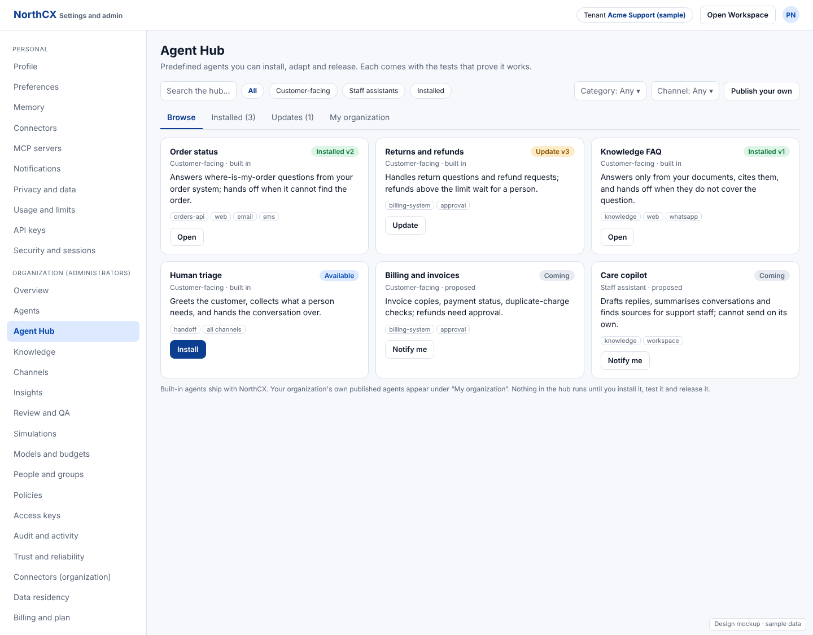
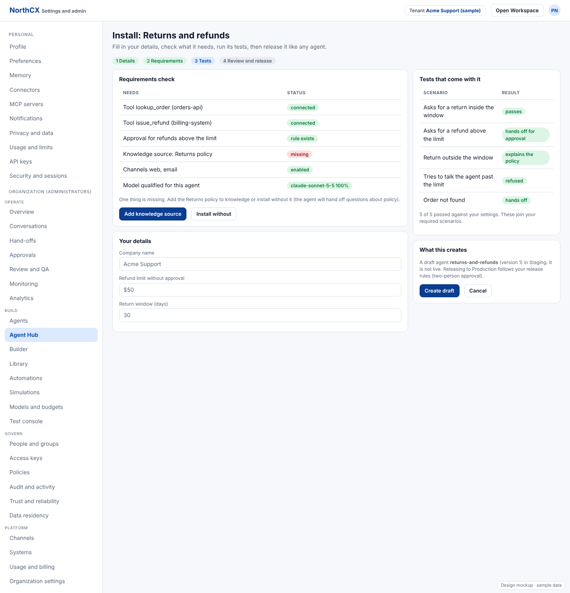
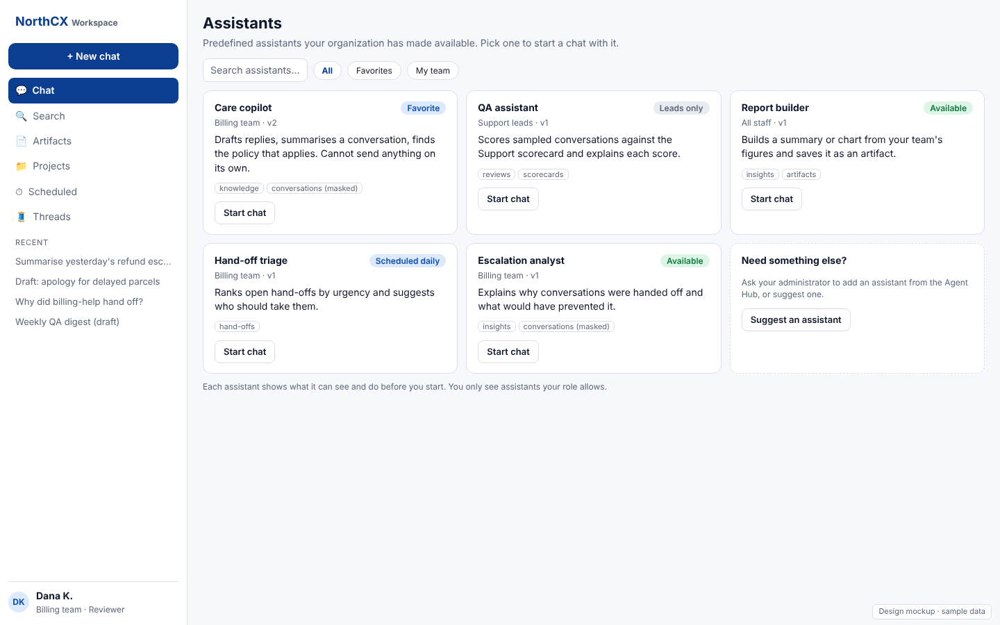

# Agent Hub and predefined agents: design proposal

Status: **Designed**. Updated: 2026-11-09. Master for: the Agent Hub and predefined agents. What exists today is named under section 2; the rest is design. Mockups are static, sample data.

## 1. What it is
The **Agent Hub** is a gallery of predefined agents. A person installs one, fills in its details, checks what it needs, runs its tests, and releases it the same way as any agent. It exists for two audiences:

- **Admin** (Agent Hub in Settings and admin): browse, install, update, publish the organization's own agents, retire.
- **Workspace** (**Assistants**, a tab in the left navigation, second after Chat): staff browse and start a chat with the assistants their organization has made available.

## 2. What exists today
Four built-in **templates** (`northcx/template_library/`): order status, returns and refunds, knowledge FAQ, human triage. Each is a YAML file with parameters, an agent spec and the scenarios that prove it. The platform fills `{{name}}` placeholders in text only (nothing is evaluated), validates the result like a hand-written spec, checks that the tools it needs exist in this deployment, and can create a draft version. API: `GET /v1/templates`, `GET /v1/templates/{id}`, `POST .../render`, `POST .../create-version`. Studio has no gallery screen for them. The hub is that gallery plus the missing parts below.

## 3. What a hub entry holds
Today's template fields (title, intent, description, parameters, required tools, spec, scenarios) plus, proposed: **audience** (customer-facing or staff), **category**, **channels it suits**, **connectors and knowledge it needs**, **models qualified for it** (from the selection design), **version and change notes**, **publisher** (built in, your organization), and **what it can see and do** in plain words (shown before anyone starts a chat). Entries are files, versioned and reviewable, like templates.

## 4. Install flow (four steps)
1. **Details:** the template's parameters (company name, limits, windows).
2. **Requirements:** tools connected, approval rules present, knowledge sources present, channels enabled, a model qualified for this agent. Each is checked and shown as met or missing; missing items link to where to fix them, or the agent can be installed without a soft requirement (it then hands off what it cannot answer).
3. **Tests:** the template's scenarios run against the person's settings; the result is shown. Passing scenarios join the required scenarios.
4. **Create draft:** a draft version in Staging. It is never live from the hub; release follows the organization's rules (reviewer, two-person rule in Production).

Staff assistants install the same way, with the extra step of choosing who may use them (people, groups) and what they may see.

## 5. Updates and the organization's own hub
- **Updates:** when a built-in entry has a new version, installed copies show "Update available" with a diff of the spec and scenarios; updating creates a new draft version, never changes a live agent. Local edits are kept as a visible difference.
- **My organization:** an agent can be published as a template inside the tenant (parameters chosen, secrets removed, scenarios attached) so other teams install it. Publishing needs a reviewer. Sharing outside the organization (a community or paid marketplace) is **not** proposed here; it depends on the open-versus-commercial decision (D1).
- **Provenance:** built-in entries ship signed with the release; entries from the organization record who published them and who reviewed them.

## 6. Proposed predefined agents
Four exist; the rest are proposals, each to be built with its scenarios.

| Agent | Audience | Does | Needs | Status |
|---|---|---|---|---|
| Order status | Customer | Answers where-is-my-order from the order system | order tool | Built |
| Returns and refunds | Customer | Return questions and refunds, over-limit refunds wait for a person | order and refund tools, approval | Built |
| Knowledge FAQ | Customer | Answers only from your documents, with citations | knowledge | Built |
| Human triage | Customer | Collects details and hands over | hand-off queue | Built |
| Billing and invoices | Customer | Invoice copies, payment status, duplicate-charge checks | billing tools, approval | Proposed |
| Appointments | Customer | Book, move, cancel | calendar tool | Proposed |
| Account help | Customer | Password and access help after an identity code check | identity verification | Proposed |
| Delivery problems | Customer | Missing or late parcels, claims, escalation | carrier and order tools | Proposed |
| Plan change and cancellation | Customer | Changes, cancellations, offers within limits | billing tools, approval | Proposed |
| Complaint handling | Customer | Listens, records, escalates with context | hand-off | Proposed |
| Front door | Customer | Language and intent routing to other agents | routing | Proposed |
| Care copilot | Staff | Drafts replies, summarises conversations, finds the policy that applies; cannot send | knowledge, conversations (masked) | Proposed (needs E5) |
| Hand-off triage | Staff | Ranks open hand-offs by urgency, suggests who takes them | hand-offs | Proposed (E5, E8) |
| QA assistant | Staff | Scores sampled conversations against a scorecard | reviews, scorecards | Proposed (E7) |
| Report builder | Staff | Builds summaries and charts from team figures, saves artifacts | insights, artifacts | Proposed (E5, E6) |
| Escalation analyst | Staff | Explains why conversations were handed off | insights, conversations (masked) | Proposed |
| Knowledge curator | Staff | Suggests articles from resolved cases | knowledge, reviews | Proposed |

Each proposed agent is a content task (instructions, parameters, scenarios) plus any tool it needs; customer agents run on what exists today, staff agents wait for the staff backend.

## 7. Safety rules for the hub
Installing never makes an agent live; every install passes its scenarios and the organization's release rules; templates cannot execute code (placeholder filling only, as today); requirements are checked against the real deployment; staff assistants declare what they can see and do, and inherit the signed-in person's permissions (never more); a hub entry cannot widen a tool's scope or an organization policy lock.

## 8. Work packages (proposed epic E22, after the build of the shell and the providers work)
| WP | Work | Size |
|---|---|---|
| 22.1 | Extend the template schema (audience, category, channels, needs, version, notes, what it can see and do), keep existing files valid, API returns the new fields | S |
| 22.2 | Requirements check endpoint (tools, approvals, knowledge, channels, qualified model) | M |
| 22.3 | Install flow API: render, check, run scenarios against the settings, create draft; install record per agent (template and version) | M |
| 22.4 | Updates: version compare, spec and scenario diff, create new draft, keep local differences visible | M |
| 22.5 | Organization templates: publish an agent as a template with review, share within the tenant | M |
| 22.6 | Screens: Admin Agent Hub (browse, installed, updates, my organization, install wizard) and Workspace Assistants | M |
| 22.7 | Author predefined customer agents (billing, appointments, account help, delivery, plan change, complaints, front door), each with at least 5 scenarios | L |
| 22.8 | Author predefined staff assistants once E5 to E7 exist | L |
| 22.9 | Signing of built-in entries and provenance records | S |

## 9. Decisions (decided by the owner, 2026-11-09, decision 165)
1. **Scope:** the hub is inside one organization only for now; a shared marketplace waits for the open-versus-commercial decision (D1).
2. **Who may install:** developers install into Staging; release managers release; administrators see everything.
3. **First predefined customer agents:** billing and invoices, delivery problems and account help, because they use tools and approvals that already exist.
4. **Names:** "Agent Hub" (Admin) and "Assistants" (Workspace), as drawn.
