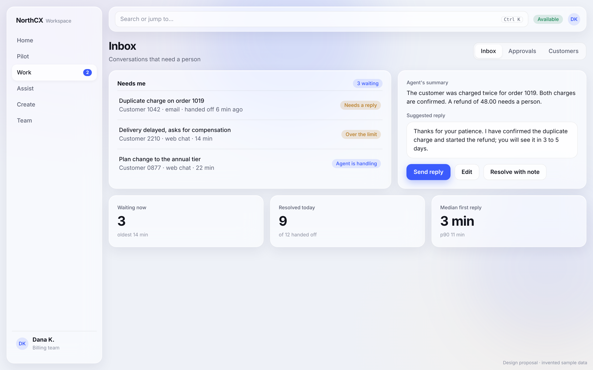
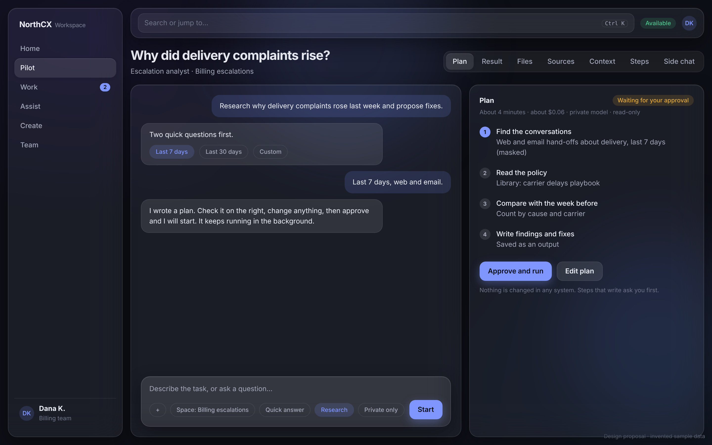
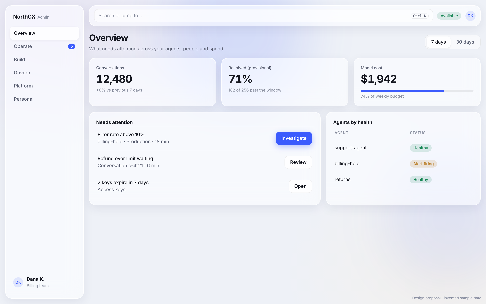

# NorthCX UI and UX design proposal

Status: **Proposed**. Updated: 2026-11-09. Master for: the visual and interaction design of the Workspace and Admin apps (colour, glass surfaces, type, layout, motion, components, accessibility). A proposal for the owner to confirm; nothing here is built. It extends the glass design system outlined in `NorthCX_Design-System.md`. Tabs, names and features are in `NorthCX_Platform-Features-and-Tabs.md`. Mockups use invented sample data.

## 1. The idea in one line
Calm, translucent surfaces over a soft background, one accent colour, large quiet type and generous space, so the work (a conversation, a plan, a number) is the only thing that draws the eye.

## 2. Principles
1. **One accent.** Everything is neutral except a single accent used for the one primary action, the active state and progress. Status colours (ok, warn, bad) are separate, muted and fixed; they never follow the accent.
2. **Glass is structure, not decoration.** Translucent panels group content and separate layers (navigation, page, panel). They never carry text that needs more contrast than they provide.
3. **Depth by blur and light, not borders.** One hairline highlight on the top edge, a soft shadow, a background blur. No heavy outlines, no gradients on controls.
4. **Quiet by default.** Few elements per screen, sentence-case labels, one primary button per view, numbers large and tabular.
5. **Honest and legible first.** If transparency would hurt readability, the surface turns solid. Contrast never depends on what is behind the glass.
6. **Same layout everywhere.** Both apps share one shell: a floating left rail of six items, a command bar on top, sub-tabs as a segmented control, content in glass cards.

## 3. Colour (minimal palette)
| Role | Light | Dark | Use |
|---|---|---|---|
| Background | soft mist gradient (`#eef1f7` to `#e6e4f2`) with two faint accent-tinted orbs | graphite (`#0d0f16` to `#141226`) with the same orbs | Behind everything; the orbs make the blur visible |
| Ink | `#14161f` | `#eceef6` | Text and headings |
| Muted / faint | `#5b6072` / `#8b90a0` | `#a3a8ba` / `#6f7589` | Secondary text, captions |
| Glass | white at 58% / 78% | white at 6% / 10% | Cards, rail, bars; stronger for the selected item |
| Hairline | ink at 8% | white at 8% | Dividers |
| **Accent** | `#3b5bfd` | `#7f95ff` | Primary button, active badge, progress, focus ring, selected chip |
| Status | ok `#1f8a5b`, warn `#b7791f`, bad `#c2410c` | `#4cc38a`, `#e0a63c`, `#f08a5d` | Pills only; text plus colour, never colour alone |

The accent can be changed in Preferences (a short list of calm hues); status colours stay fixed. Colour values are a proposal to tune with real contrast measurements.

## 4. Glass recipe
- Panel: `background: rgba(255,255,255,.58)`, `backdrop-filter: blur(28px) saturate(150%)`, 1 px light border, top inner highlight, soft shadow, radius 18 px.
- Selected item: the stronger glass plus a faint shadow; no coloured bar.
- **Solid fallback:** when the person sets "reduce transparency" or high contrast, when the browser lacks `backdrop-filter`, or when contrast is below AA behind a panel, panels use an opaque surface of the same hue. Nothing else changes.
- Performance: at most two blurred layers visible at once; blurs are disabled while scrolling heavy lists and on low-power devices.

## 5. Typography and spacing
- One sans-serif family (Inter or the system UI font), one monospace for traces and code. Sizes: page title 26, section 16, body 14, caption 12. Tight negative tracking on large sizes; tabular numerals for every figure.
- 8 px spacing scale; card padding 20 px; gaps 16 px; radius 18 px for cards, 12 px for controls, full for pills.
- Sentence case everywhere; no all-caps except tiny table headings.

## 6. Layout
- **Floating rail** (left, 232 px, detached from the edges): six items, a badge on the group that has waiting work, the signed-in person at the bottom.
- **Command bar** (top): search and jump (Ctrl K), availability, account. It reaches every tab and page by name.
- **Sub-tabs** are a segmented control on the right of the page title, not another sidebar.
- **Content** is a grid of glass cards: lists on the left, detail on the right; large figures in a row of three.
- **Pilot** gets the full width: conversation on the left, the plan and the other inner tabs as a glass panel on the right, and a composer that floats at the bottom.
- Works from a 1280 px laptop up; the rail collapses to icons below 1100 px; a tablet layout stacks the right panel under the conversation. A phone view is not a first-release goal.

## 7. Components
Rail item, command bar, segmented sub-tabs, glass card, stat tile (large number, caption, one delta), list row (title, meta, status pill, action), status pill, button (primary, secondary, destructive), chip (selectable), plan step with number, progress bar, message bubble (person tinted by the accent, assistant on glass), composer with chips (space, task style, model mode, **where the text goes**), citation chip, masked-field with reveal-with-reason, empty, loading and error states, toast, confirm dialog.

## 8. Interaction and motion
- Transitions 160 to 240 ms ease-out; panels slide a few pixels and fade, never bounce.
- Streaming text appears in place; a running task shows a calm progress bar and the current step, not a spinner.
- A sensitive or write action always opens a confirm step that names the exact action; the destructive button is the only red element.
- **Reduce motion** replaces all movement with fades. Hover is never required: everything works by keyboard and touch.

## 9. Accessibility (the rule that overrides the look)
Text meets WCAG 2.1 AA in every theme and on every surface; the high-contrast setting switches to solid surfaces and stronger borders; focus is a visible 2 px accent ring; every control has a label; status never relies on colour alone; text size and density are adjustable (Preferences); the whole app works with the keyboard. Contrast is verified by an automated check on each screen in light, dark and high contrast before a release.

## 10. Themes and preferences
Match device, light or dark; accent; density (comfortable or compact); text size; high contrast; reduce motion; reduce transparency. Saved per browser first, per person once the backend exists. Applied through `data-theme`, `data-accent`, `data-density`, `data-text`, `data-contrast`, `data-motion` and `data-glass` attributes on the root element.

## 11. What would make it feel 2026 without becoming noisy
Large quiet headings; a single glowing primary button; blur and light for depth; micro-detail such as a soft inner highlight and tabular numbers; AI work shown as a plan and a steps list instead of a spinner; a command bar as the main way to jump. What it deliberately avoids: many colours, gradients on controls, heavy shadows, dense tables with borders everywhere, decorative animation.

## 12. Open questions for the owner
1. **Accent colour:** the proposal uses a calm blue. Alternatives: a deep teal or a graphite-only look with no accent hue.
2. **Default theme:** match the device (recommended), or light first.
3. **Brand mark:** a wordmark only for now (as drawn), or a symbol.
4. **Density:** comfortable by default (as drawn) or compact for the Admin app.

Mockup source: `scripts/gen_ui_proposal.py` (HTML in `07-design/mockups/ui-*.html`, images in `assets/design/ui-*.png`).
