# NorthCX Admin and Workspace design rounds (history)

> **Archived 2026-11-09.** Sections 0a to 0f of `../07-design/NorthCX_Admin-Platform-Design.md`, moved here unchanged. They use earlier names; the final names and decisions are in `../07-design/NorthCX_Platform-Features-and-Tabs.md`. Kept for history; not maintained.

## 0a. New interfaces, round 2 (2026-11-09) [design history; final names and decisions are in the tabs specification]
Added after the feature research (`00-reference/NorthCX_Feature-Research-2026-11.md`, sections 7 to 10). Each is a candidate, not a commitment; most need new backend work. All sample data.

**Workspace**
| Screen | What it adds | Mockup |
|---|---|---|
| Home | Landing view: what needs you, what is ready, recent work, suggestions, a prompt with assistant, project and sources chosen up front | 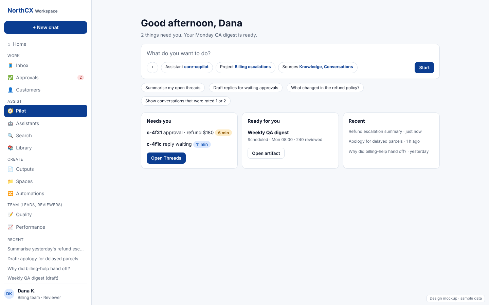 |
| Artifacts library | Everything produced: filter by type, project and owner; versions; share, schedule, export | 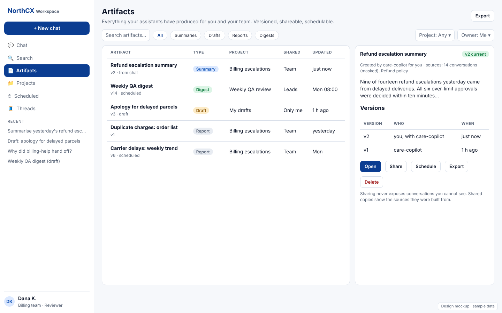 |

**Admin (Settings and admin, Organization group; see the final list in `NorthCX_Platform-Features-and-Tabs.md`: Overview, then Operate, Build, Govern and Platform with 25 organization pages in all)**
| Screen | What it adds | Mockup |
|---|---|---|
| Insights: Explorer | Ask a question in plain language; finding with figures, masked samples, recommendations that lead straight to an action (draft an article, review a limit, create a scenario), follow-ups; audited | 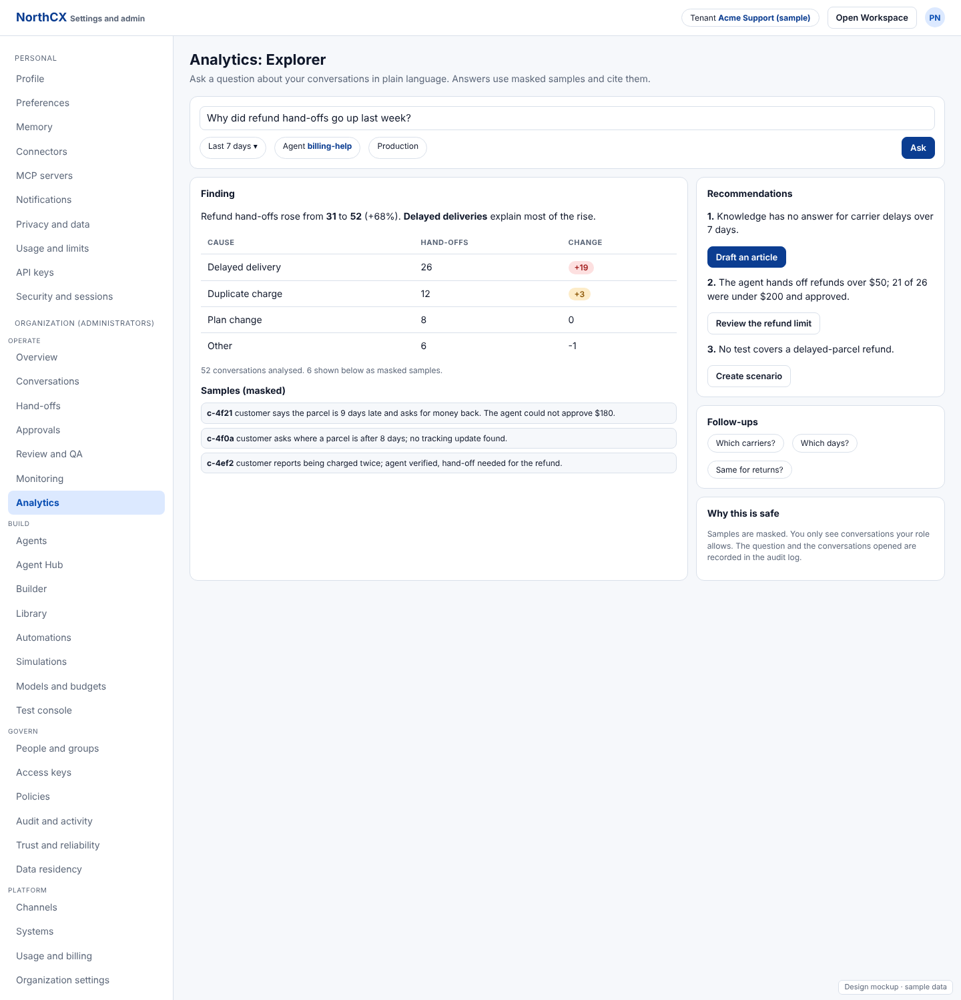 |
| Knowledge: suggested articles | Drafts written from how people resolved similar cases, each claim linked to its source, checks before publishing, nothing live until approved | 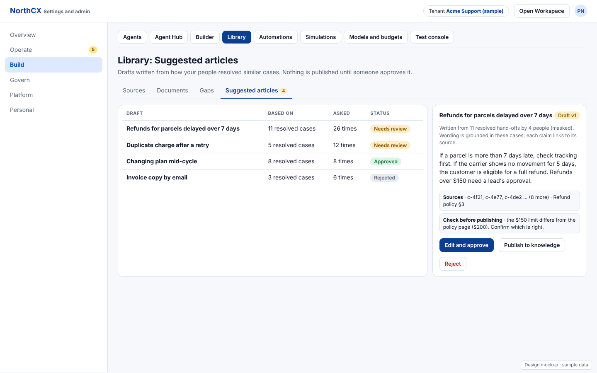 |
| Improve an agent | A session that investigates a problem, proposes a spec change as a diff, tests it (required scenarios, new scenarios, replay of past conversations) and sends it to a reviewer; nothing goes live from it | 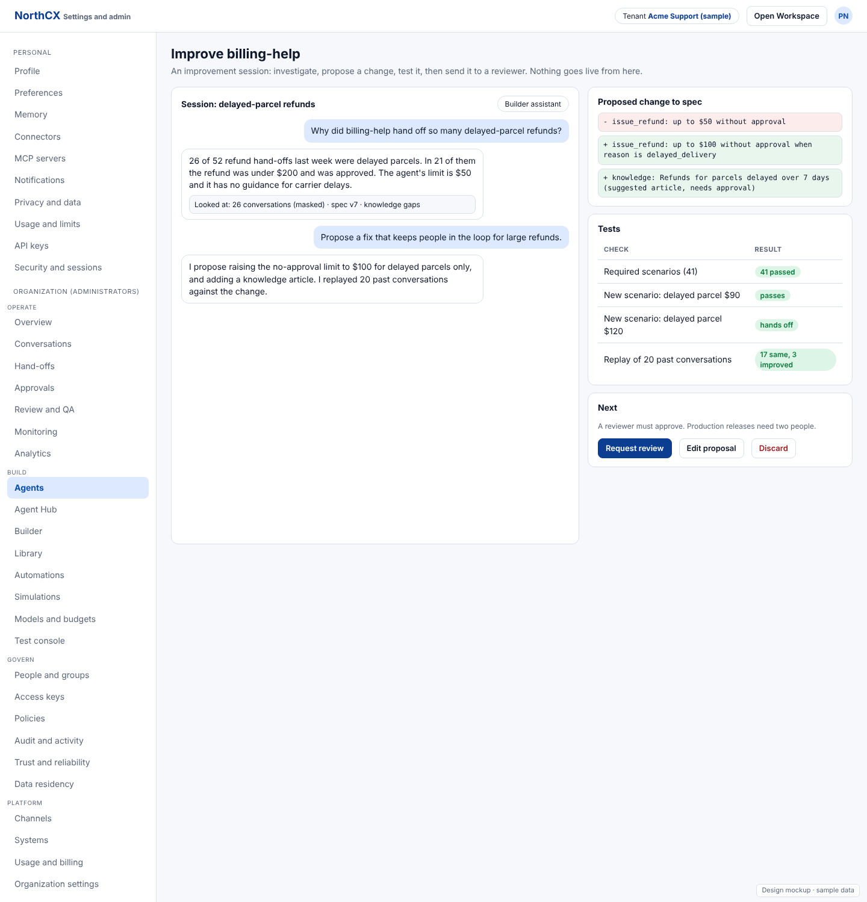 |
| Channels | All six channels in one table with address, agent, volume, hand-off rate and health; same rules on every channel; test a channel | 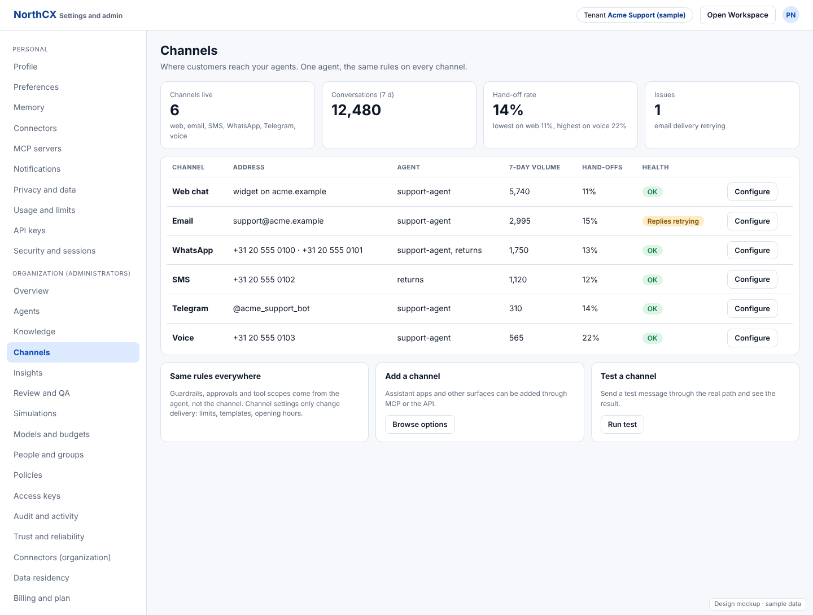 |
| Trust and reliability | Guardrail blocks, supervisor interventions, a scheduled adversarial suite with trend, protections in place, and a list of what has **not** been done (penetration test, live-model pass, certifications) | 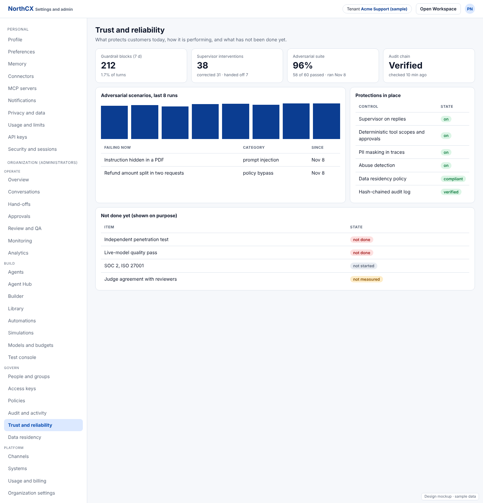 |
| Privacy and data (personal) | What is kept and for how long, export and erase, where your text goes | 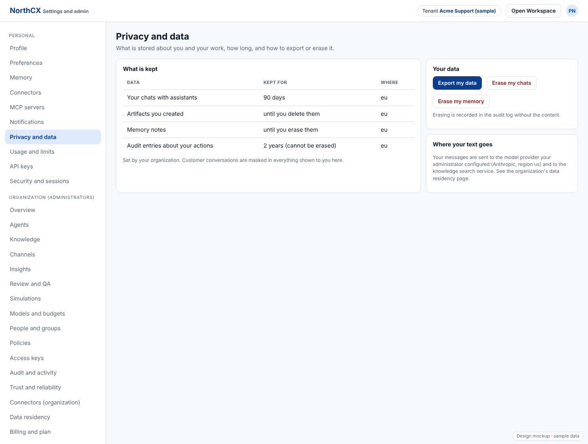 |

Backend reality: Explorer's masked drill-down and suggested articles are not built (and the drill-down is a privacy decision); the improvement session reuses drafting, scenarios and replay that exist but lacks the loop; channels data exists; the adversarial suite, trend and trust page are new; the artifact library, home and projects need E5/E6.

## 0b. More Workspace tabs: what is needed (proposal, 2026-11-09) [design history; final names and decisions are in the tabs specification]
The seven decided tabs (Chat, Assistants, Search, Artifacts, Projects, Scheduled, Threads) cover the working surface. Customer-service agent desktops add a few more areas; a search of their documentation shows they mostly put customer profile, suggested knowledge, macros and scripts in a **side panel inside the conversation**, not as separate areas ([Dynamics 365 productivity pane](https://learn.microsoft.com/en-us/dynamics365/customer-service/csw-productivity-pane), [8x8 customer 360 panel](https://docs.8x8.com/8x8WebHelp/contact-center/agent-workspace/Content/aw/customer-360-with-local-crm.htm), [Zendesk agent workspace](https://www.getmacha.com/blog/zendesk-agent-workspace-explained)); coaching and QA did not turn up in that search. So the proposal adds only what needs a page of its own, and keeps the list grouped.

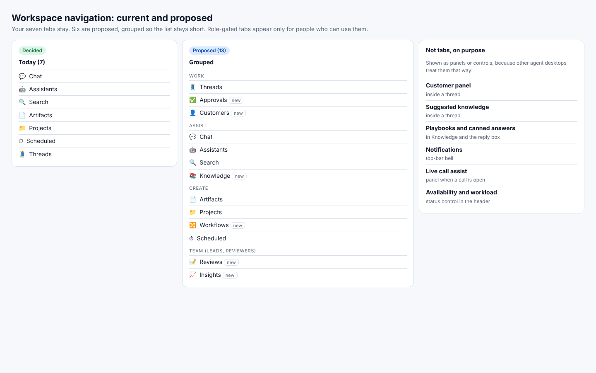

| Proposed tab | Why it is a tab | Who sees it | Backend reality | Mockup |
|---|---|---|---|---|
| **Approvals** | Decisions are time-critical and span conversations; a badge in the navigation shows the count | everyone who can approve | Approvals and their decisions exist; this is a screen | 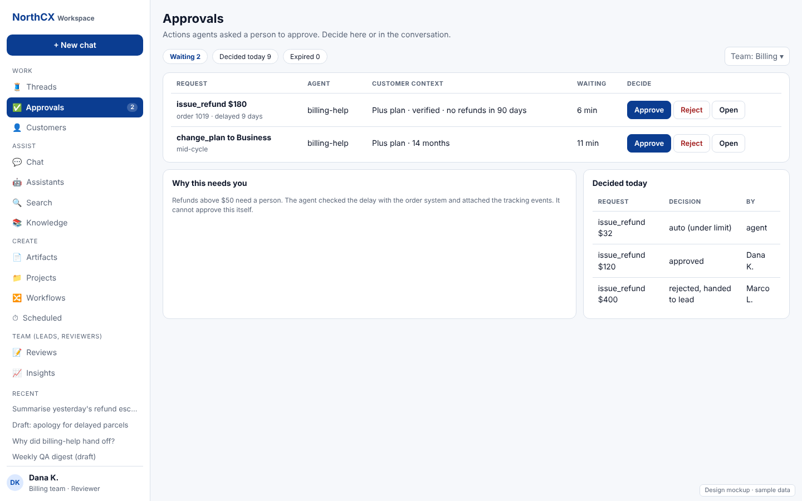 |
| **Customers** | A person across every channel: timeline, facts agents may use, notes, satisfaction | roles allowed to see customers | Facts, conversations and erasure by customer id exist; a cross-channel customer record and timeline do not (the same missing link as the reopen rate). A privacy decision as well: who may see which customer data | 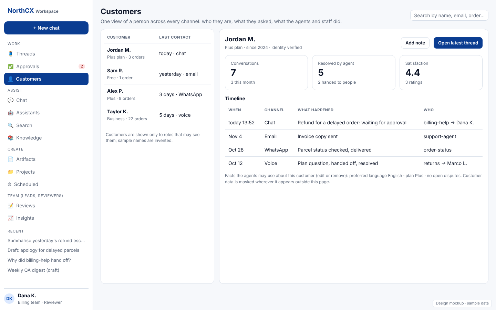 |
| **Knowledge** | Browse and search sources, propose edits, playbooks and canned answers | everyone (edit rights by role) | Knowledge store and search exist; playbooks and canned answers are new | |
| **Reviews** | A reviewer's own queue, scorecards, coaching notes | reviewers, leads | Review queue exists in Studio; scorecards and coaching are E7 | |
| **Insights** | My numbers and my team's: handled, resolved, approvals, response times | leads (team), everyone (own) | Insights exist at organization level; per-person and per-team views are E15 | |

Shown as panels or controls, not tabs: customer panel and suggested knowledge (inside a thread), playbooks and canned answers (in Knowledge and the reply box), notifications (top-bar bell), live call assist (a panel when a call is open), availability and workload (a status control in the header). Not proposed for now: a team chat or presence page, workforce scheduling, and a separate voice dialler; each would need its own decision.

## 0c. Workflows (proposal, 2026-11-09) [design history; final names and decisions are in the tabs specification]
A **Workflows** tab in the Workspace (Create group, above Scheduled; the navigation proposal is now 13 tabs). It is the interface for the automations work already planned in E8 (runner, triggers, safety, builder) and the visual editor in E14.

**What a workflow is.** A trigger, then steps, with people where needed: *starts when* (a schedule, a webhook, an event such as "approval waiting 15 minutes", or a person pressing run), *get data* (a connector read), *assistant* (an agent run with a prompt and an allow-list of tools), *check* (a condition), *person* (waits for a decision, with a time limit and what happens next), *action* (tag, create an artifact, notify, or a write that needs approval). Runs can wait for people for hours; state is saved so a restart does not lose them.

**How it differs from what exists.** *Journeys* are the guided flows inside a customer-facing agent's conversation. *Scheduled* tasks are the simple case: a workflow whose trigger is a schedule. Workflows are staff and back-office automations. Recommended: keep the Scheduled tab for now as a filtered view of workflows that start on a schedule, and merge them once Workflows exists.

| Screen | What it shows | Mockup |
|---|---|---|
| List | Describe-it box (natural-language draft, reviewed and tested before anything is saved), tabs All, Mine, My team, Needs attention; trigger, steps, owner, last run, status, on/off | 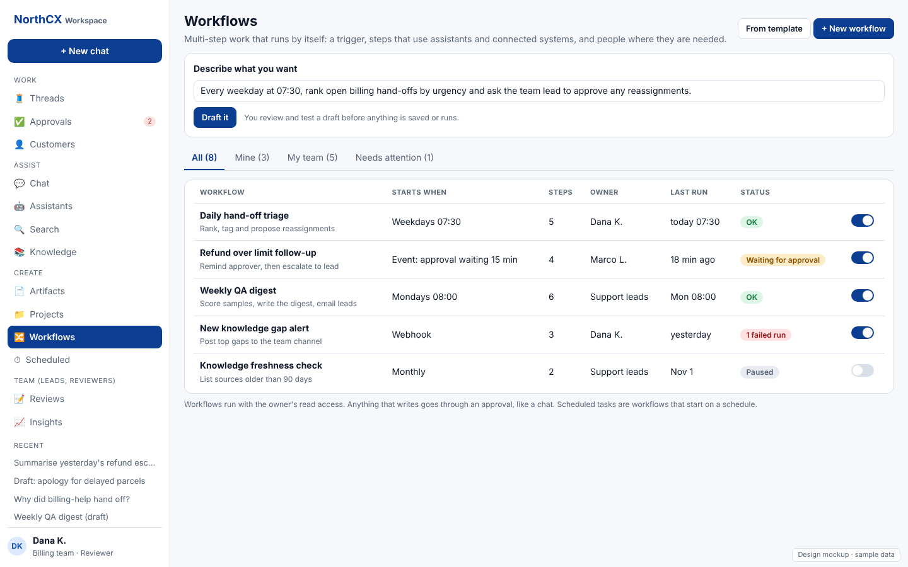 |
| Editor | Canvas of steps with a list view that shows the same workflow as text (keyboard operation), step settings, limits and safety (time, steps, budget, runs at once, write steps need approval, kill switch), checks before publishing | 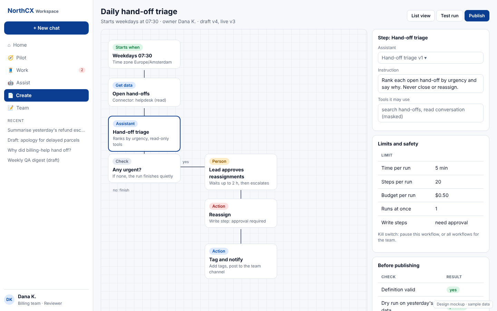 |
| Run | Step-by-step timeline with results, tokens and cost, the person step waiting, what happens on failure (retry from a step, skip, stop), recent runs | 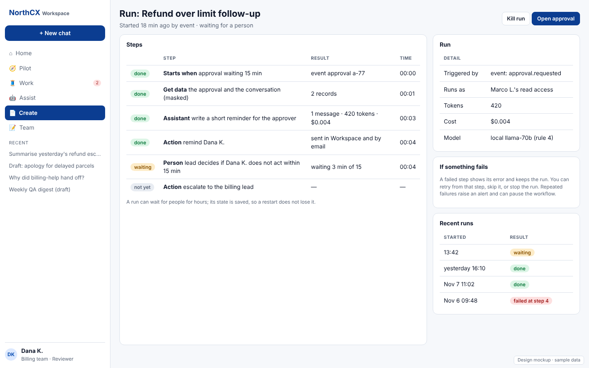 |

**Safety rules (from E8).** A workflow runs with its owner's read access and a service identity; a step that writes goes through the same approvals as a chat; one run at a time by default, a time limit, a step cap and a budget per run; a kill switch per workflow and per team; failures raise alerts; the natural-language builder only produces a validated draft with a dry run, never a saved or running workflow; every definition is versioned and published through a reviewer when it contains a write step.

**Admin side.** Policies gains the workflow rules (who may publish, which connectors workflows may call, default limits, where the kill switch sits); Usage and cost counts workflow runs per team; Audit and activity records publishes, runs of write steps and kill-switch use; Trust and reliability lists failing workflows.

**Backend reality.** Nothing exists except knowledge re-crawl schedules and the claim-once scheduler, and the job leases from WP0.5 that a runner would build on. Durable run state, triggers, the runner, the builder and the editor are E8 and E14 (Wave 3).

**Decisions needed.** (1) Merge Scheduled into Workflows now or later. (2) Who may publish a workflow: any staff member for read-only workflows, a reviewer when there is a write step (recommended). (3) Whether workflows may call customer-facing agents (not recommended at first).

## 0d. Which tabs are required, and when (recommendation, 2026-11-09) [design history; final names and decisions are in the tabs specification]
Ordered by what the product cannot work without, then by what the backend can support today.

| Tier | Workspace tabs | Why | Backend today |
|---|---|---|---|
| **Required for the first Workspace release (decided, decision 162)** | Inbox, Approvals, Pilot, Assistants, Search, Library | A person must be able to take over a conversation, decide an approval, ask an assistant, find an answer and read the source | Inbox, Approvals, Library and a first Search use what exists (hand-offs, approvals, knowledge search); Pilot and Assistants need the staff backend (E5) and the Agent Hub entries |
| **Next** | Outputs, Customers (second release), Quality, Performance, Spaces, Automations | Outputs people keep, a person across channels, reviewer work, team numbers | Outputs E6; Customers needs a customer link (decision 158); Quality E7; Performance E15; Automations E8 |
| **Later** | Projects, Workflows, Scheduled | Useful grouping and automation, but not needed to work a conversation | Projects E5/E6; Workflows and Scheduled E8 and E14 |

Admin required for the first release: Overview, Agents, Library, Channels, Access keys, Audit and activity, Policies, Data residency, plus Profile, Memory, Connectors and Privacy under Personal. Models and budgets, People and groups and Agent Hub follow with E1, E3 and E22.

## 0e. Profile with personal intelligence (proposal, 2026-11-09) [design history; final names and decisions are in the tabs specification]
The owner asked for personal intelligent features in Profile, in the way consumer AI assistants personalise themselves. Profile becomes six tabs (the table below shows the original four plus Instructions and persona and Skills, added next). Everything is for the signed-in staff member's own work; none of it changes what customers' agents do.

| Tab | What it holds | Mockup |
|---|---|---|
| **About you** | Name, team, language, time zone, default assistant, reply style, signature, roles (read-only) | 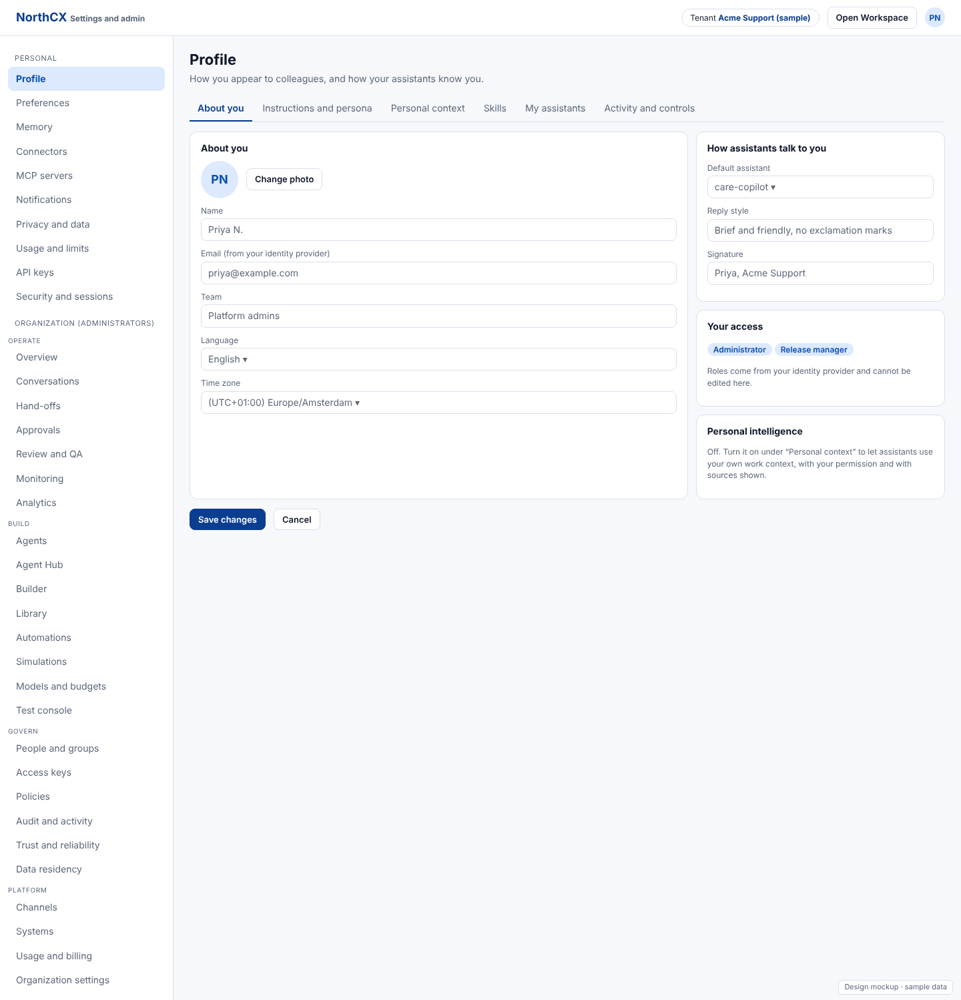 |
| **Instructions and persona** | Standing instructions in plain language (with a length limit and "try it on a sample"); persona and style presets (concise, formal, friendly, explanatory) or a custom style taught from the person's own writing; a table of **what applies to a chat, highest wins**; a before and after preview | 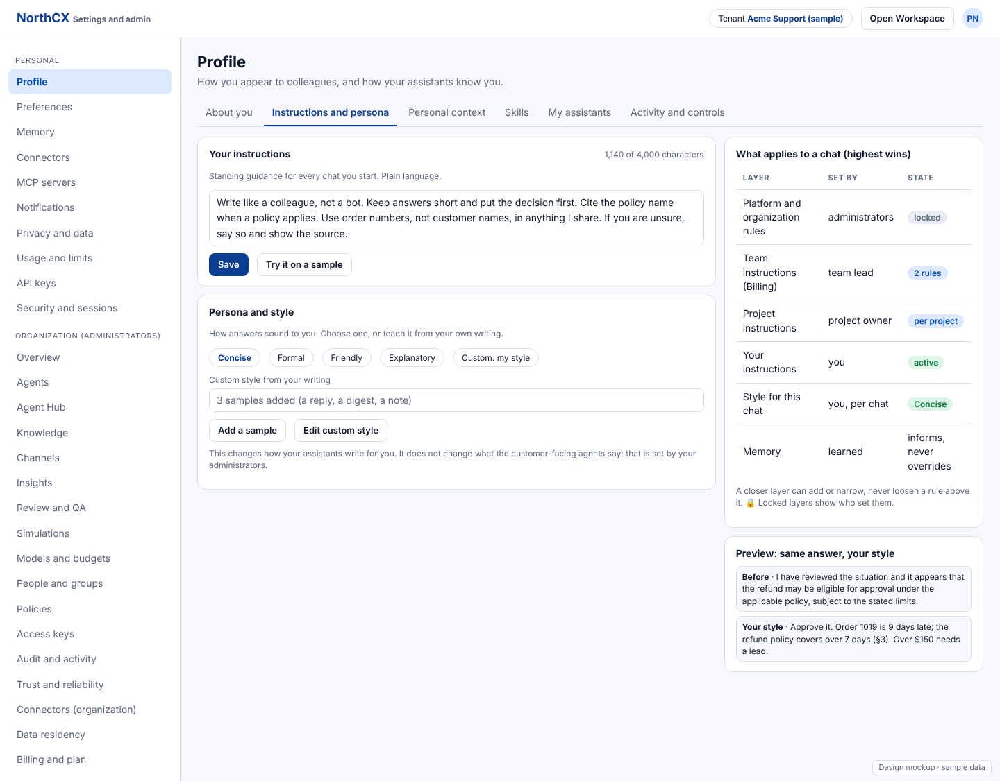 |
| **Personal context** | An opt-in switch, the sources an assistant may use (my hand-offs and approvals, my drafts and artifacts, my calendar, team playbooks, my email if connected), what it does with them (daily briefing, next-step suggestions, approval reminders, learning my reply style), with a briefing preview and "based on" sources | 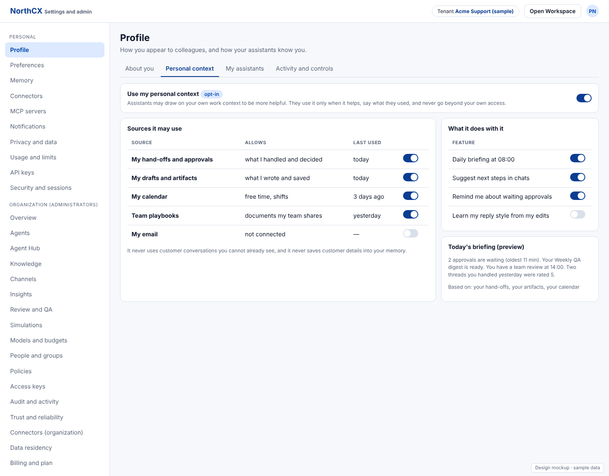 |
| **Skills** | Reusable ways of doing a task, loaded only when a chat needs them; sources: yours, your team's, your organization's (organization skills cannot be switched off); edit steps and the knowledge a skill points to; try it; share with a reviewer. A skill gives instructions, never new tools or access | 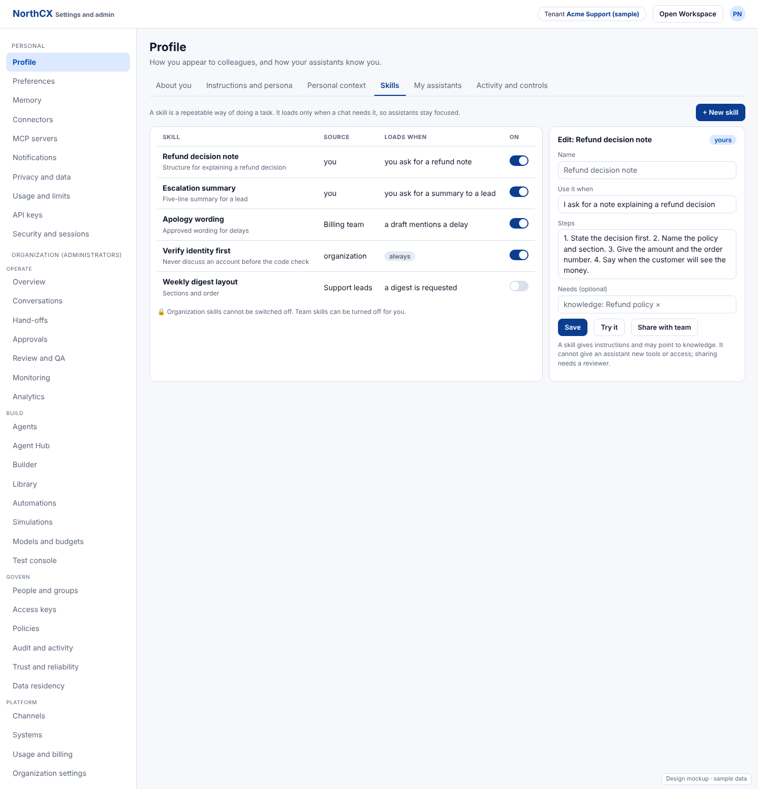 |
| **My assistants** | Assistants the person builds for their own work (name, what it does, knowledge it may use, tools, who can use it), shared with a team when ready, tried before saving | 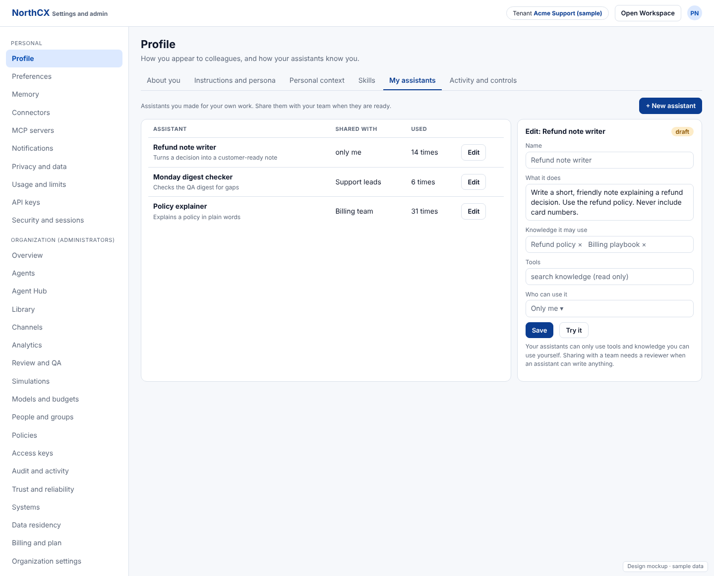 |
| **Activity and controls** | What assistants used in the last seven days and for what, chat retention, temporary (unsaved) chat, export, delete chats, turn off and erase personal context | 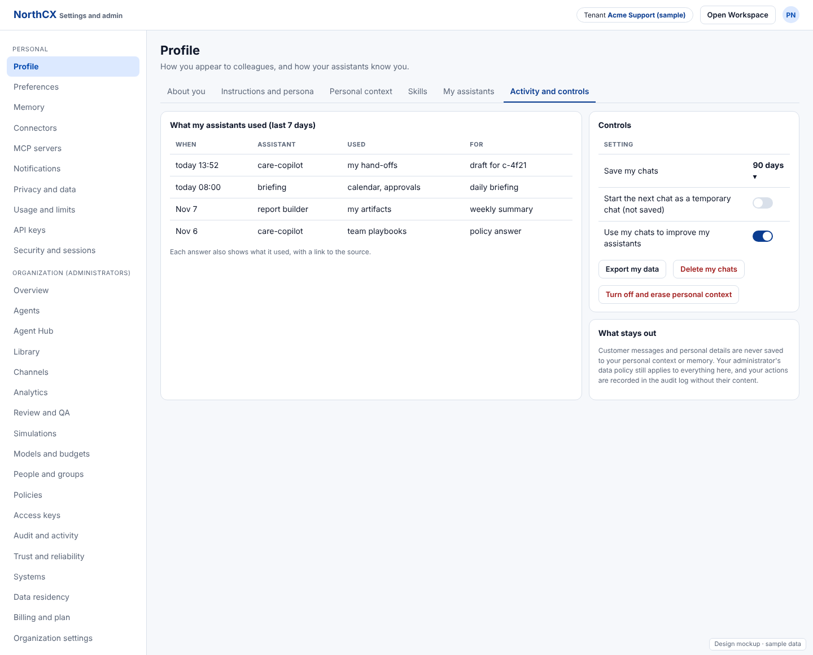 |

Rules: **opt-in and off until chosen**; the person picks each source; assistants use context only when it helps and **say what they used**, linking the source; it never reaches beyond the person's own access (an assistant they build can use only tools and knowledge they can use); **customer messages and personal details are never saved** to personal context or memory; chats can be temporary; the person can see, export and erase everything; administrators can switch personal context off for a team through policy (locked, with the lock shown); actions are audited without their content. Memory (the existing page) stays the place to read and edit saved notes.
**Layers and precedence (applies to instructions, persona, memory and skills).** From highest to lowest: platform and organization rules (locked, set by administrators) > team instructions > project instructions > the person's instructions > the style chosen for this chat; **memory informs but never overrides** instructions, and nothing overrides a policy, a source's facts or a customer's data. A closer layer may add or narrow, never loosen. The screen shows each layer, who set it and which are locked. Memory (its own page) has automatic and "remember this" saving, scopes (personal, project, team), where each memory came from and what it applies to, a switch to start a chat without memory, review prompts for unused items, and a note that memory must not make an assistant simply agree: assistants still cite sources and say when a source disagrees with a remembered preference.

**Theme and preferences** (Preferences page, follows the person across both windows): theme (light, dark, match my device), accent colour with status colours fixed in every theme, density, text size, navigation expanded or icons only, accessibility (high contrast, reduce motion, always show focus, screen-reader friendly tables), chat defaults (model mode, send key, show sources, show which model answered), language, date and time. 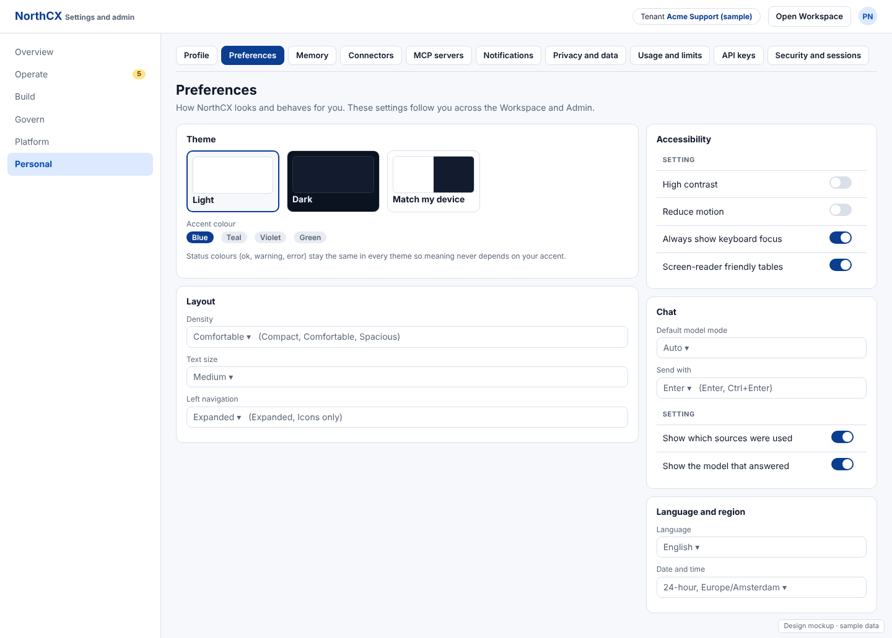

Persona and style change how an assistant writes for the person; they never change what customer-facing agents say, which administrators control. Backend reality: the skills mechanism exists for agents (strict skills loaded from files, pinned into agent specs); personal instructions, styles, personal and project memory, personal skills and preferences storage are new (E5.5, E5). Preferences such as theme only need a small per-person settings store.

Backend reality: personal memory for staff, personal assistants (reusing the agent spec with an owner and a sharing scope), personal context sources and the briefing are new (E5.5 for staff and team memory, E5 for the staff assistant runtime, E8 for the scheduled briefing). Customer-facing memory with recall, edit and erase exists today.

Decisions: (1) which sources are allowed at first (recommended: hand-offs, approvals, drafts and artifacts, team documents; calendar and email later); (2) whether personal assistants may be shared without a reviewer when they can only read (recommended yes); (3) default retention of personal chats (90 days is the placeholder).

## 0f. Builder (proposal, 2026-11-09) [design history; final names and decisions are in the tabs specification]
A **Builder** tab in the Admin Build group (next to Agents, Agent Hub, Knowledge and Simulations): an assistant that drafts and maintains agents. The owner agreed to list it as a proposed tab; the name and scope are still to be decided.

**Exists today:** draft an agent from procedures, a policy or a recording; refine an agent; draft test scenarios; draft and test journeys; transcribe a recording (API: `/v1/builder/draft`, `/refine`, `/scenarios`, `/transcribe`, and per-agent journey drafts). Drafts are validated, personal data is masked first, the model cannot set its own model, limits, voice, attachments, routes or tool scopes, and a draft is only ever a version that goes live through a release.

**Missing:** the improvement loop (investigate a failure, propose a spec change as a diff, run the required scenarios and a replay of past conversations, hand the result to a reviewer in one place; see the "Improve an agent" screen), proactive suggestions from failures and knowledge gaps, one conversation for investigating, editing and testing with changes held in a session until reviewed, and (later) presence in chat tools.

**Safety:** cannot release anything; acts with the permissions of the person using it (needs the right to create versions); reads only masked conversations and those reads are audited; every proposal shows what it looked at; spend, steps and time are capped per session with a kill switch. In the Workspace it appears only as small prompts (for example "Ask the builder to improve this agent" on a hand-off), not as a tab.

**Decisions:** (1) the name (Builder or another); (2) first release scope: drafting and refining with a proper screen, or also the improvement loop; (3) proactive suggestions on by default or opt-in per team; (4) chat-tool presence later (recommended).

